# infographics

Data-journalism graphics about Thessaly, Larissa and a few global topics, made in R / ggplot2 by Loukas Theodosiou.
Every chart below links to the script that draws it and names its data source. Nothing is estimated: if a number
could not be sourced, the chart says so or was not made.

Two projects live here:

| Folder | What it is |
|---|---|
| [`thessaly-dataviz/`](thessaly-dataviz/) | One R script per chart (`scripts/`), data in `data/`, PNGs in `out/`. Setup and status notes in [`CLAUDE.md`](thessaly-dataviz/CLAUDE.md). |
| [`Thessaly Infographic Installation/`](Thessaly%20Infographic%20Installation/) | An 18-panel printed wall exhibit (HTML + d3) with an R twin of its data figures. Notes in [`HANDOFF.md`](Thessaly%20Infographic%20Installation/HANDOFF.md). |

A browsable status board of everything is [`gallery.html`](gallery.html).

## Thessaly and Larissa

### Population density of Thessaly in 3D
[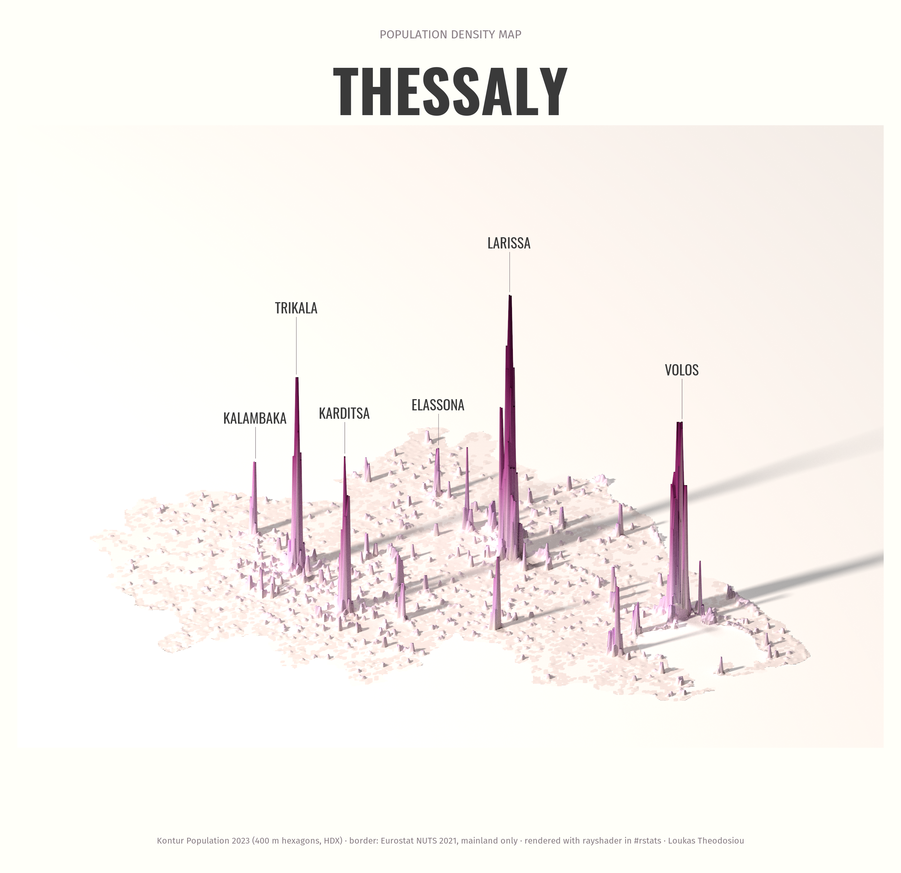](thessaly-dataviz/out/t12_thessaly_population_3d.png)
Code: [`scripts/t12_thessaly_population_3d.R`](thessaly-dataviz/scripts/t12_thessaly_population_3d.R) · Data: Kontur Population 2023, 400 m hexagons (HDX, CC BY); border Eurostat NUTS 2021, mainland only. Rendered with rayshader; labels placed with magick.

### Where Thessaly's threatened species have been seen
[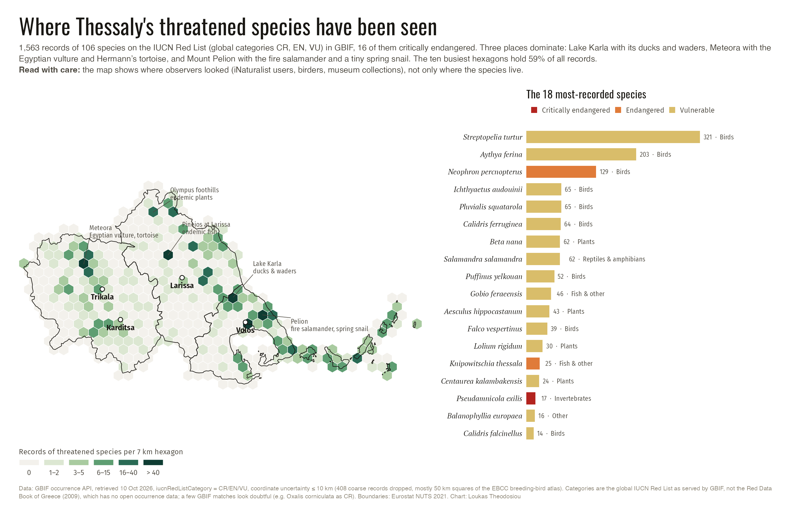](thessaly-dataviz/out/t13_threatened_species_map.png)
Code: [`scripts/t13_threatened_species_map.R`](thessaly-dataviz/scripts/t13_threatened_species_map.R), data fetched by [`scripts/00_fetch_gbif_thessaly.R`](thessaly-dataviz/scripts/00_fetch_gbif_thessaly.R) · Data: GBIF occurrence API, species in IUCN categories CR / EN / VU. The map shows where observers looked, not only where species live.

### What Thessaly sells abroad, and to whom
[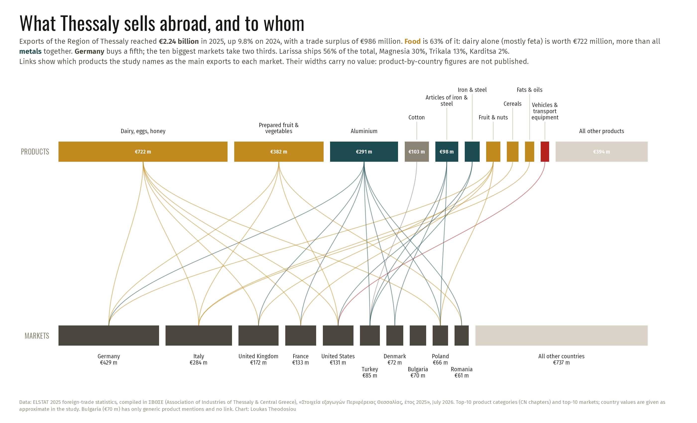](thessaly-dataviz/out/t14_thessaly_exports.png)
Code: [`scripts/t14_thessaly_exports.R`](thessaly-dataviz/scripts/t14_thessaly_exports.R) · Data: ΣΒΘΣΕ study of Thessaly's 2025 exports from ELSTAT data, typed into [`data/exports/`](thessaly-dataviz/data/exports/). Links between products and markets are qualitative; no product-by-country values are published.

### Storm Daniel 2023 as rain gauges
[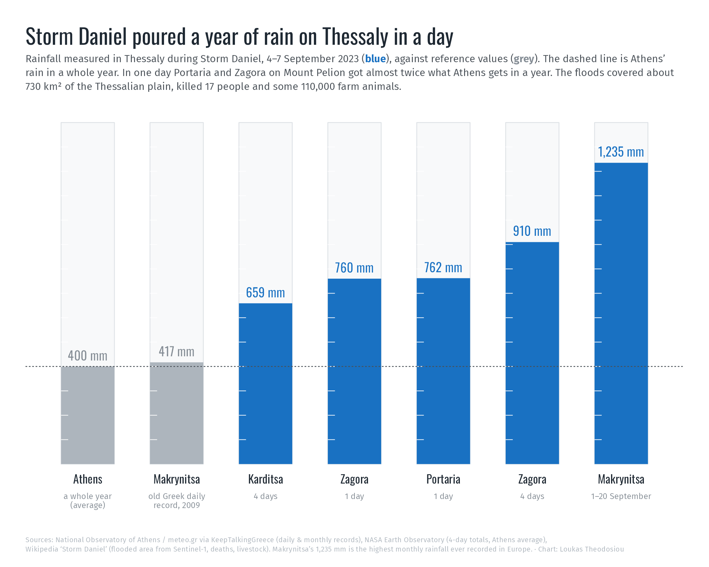](thessaly-dataviz/out/t1_storm_daniel.png)
Code: [`scripts/t1_storm_daniel.R`](thessaly-dataviz/scripts/t1_storm_daniel.R) · Data: NOA / meteo.gr records, NASA Earth Observatory.

### As Larissa votes, so votes Greece
[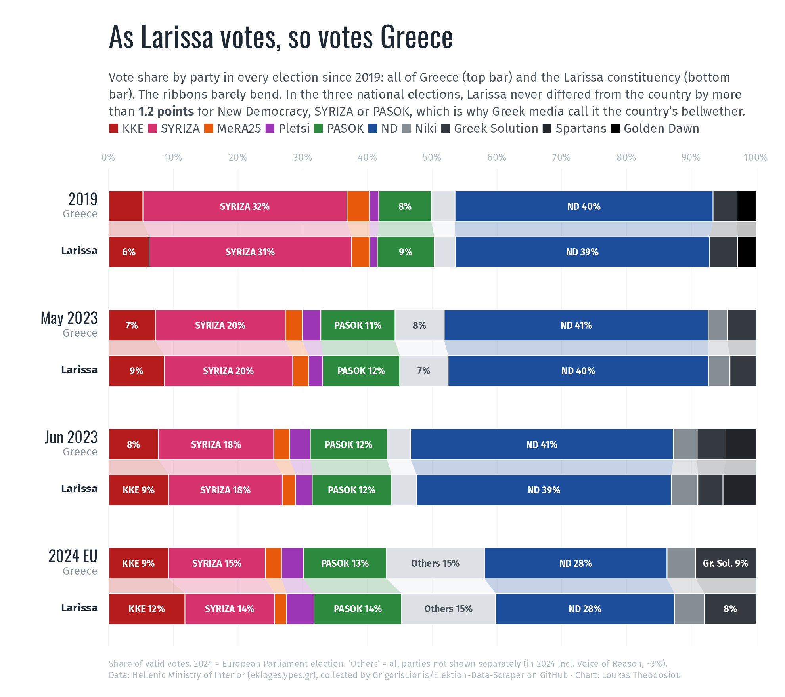](thessaly-dataviz/out/t5_larissa_bellwether.png)
Code: [`scripts/t5_larissa_bellwether.R`](thessaly-dataviz/scripts/t5_larissa_bellwether.R), data built by [`scripts/00_prep_larissa_vs_greece.R`](thessaly-dataviz/scripts/00_prep_larissa_vs_greece.R) · Data: Ministry of Interior results.

### Larissa mayor elections 2014–2023
[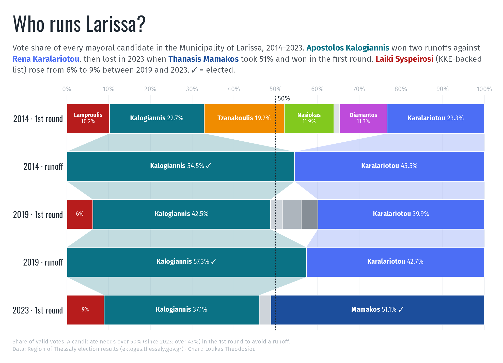](thessaly-dataviz/out/t6_larissa_mayor.png)
Code: [`scripts/t6_larissa_mayor.R`](thessaly-dataviz/scripts/t6_larissa_mayor.R) · Data: Region of Thessaly election results.

### Mayor timeline since 1975 and the deciding round of each election
[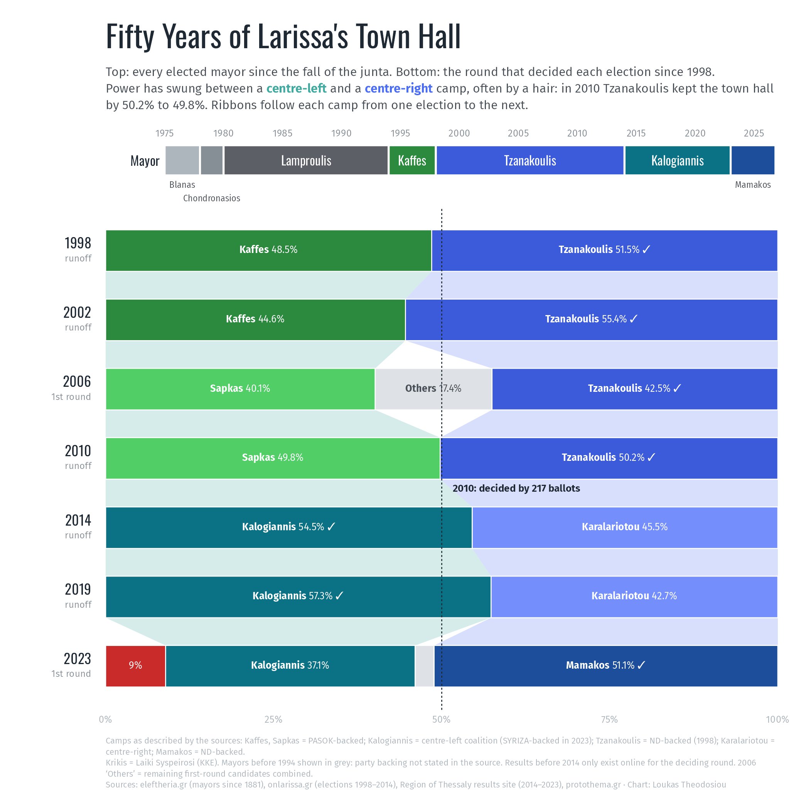](thessaly-dataviz/out/t8_larissa_mayors_history.png)
Code: [`scripts/t8_larissa_mayors_history.R`](thessaly-dataviz/scripts/t8_larissa_mayors_history.R) · Data: onlarissa.gr, eleftheria.gr, Region results.

### 145 years of Larissa mayors
[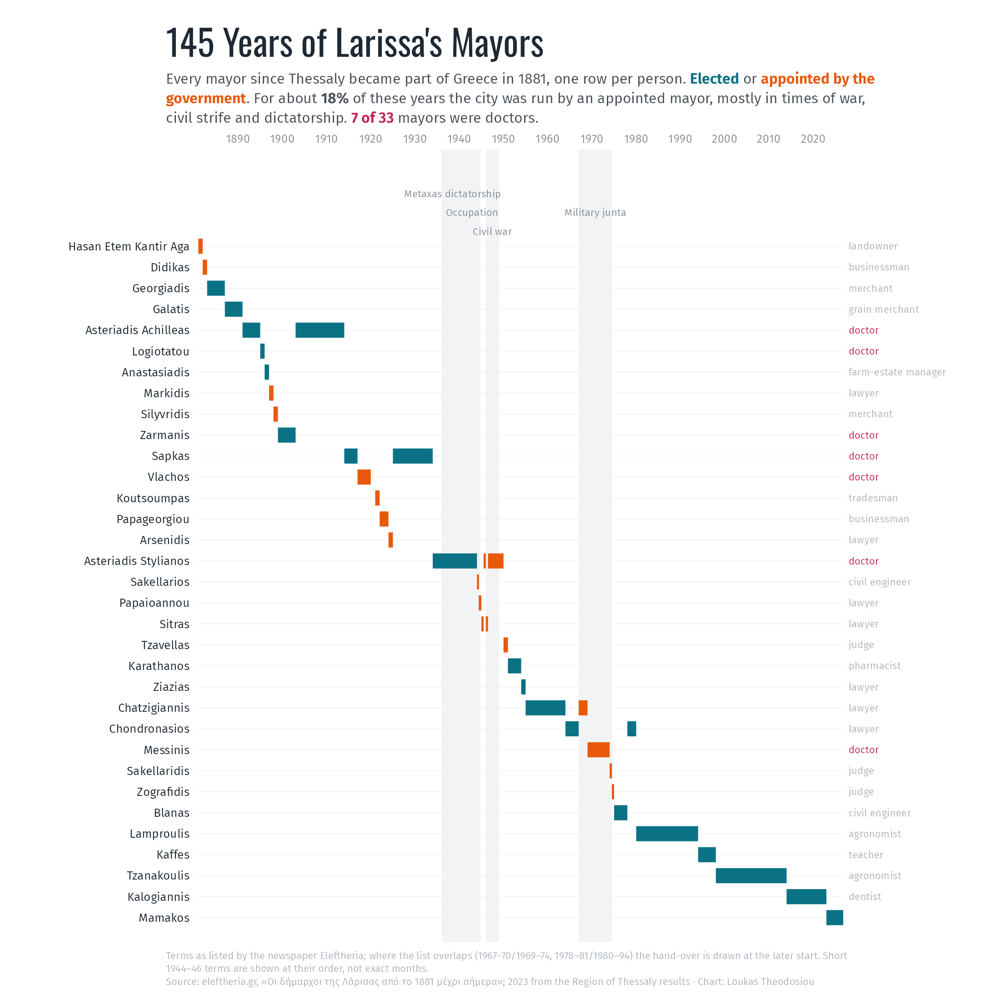](thessaly-dataviz/out/t10_larissa_mayors_1881.png)
Code: [`scripts/t10_larissa_mayors_1881.R`](thessaly-dataviz/scripts/t10_larissa_mayors_1881.R) · Data: eleftheria.gr list of mayors since 1881.

### Who ran Larissa? Professions of mayors in three eras
[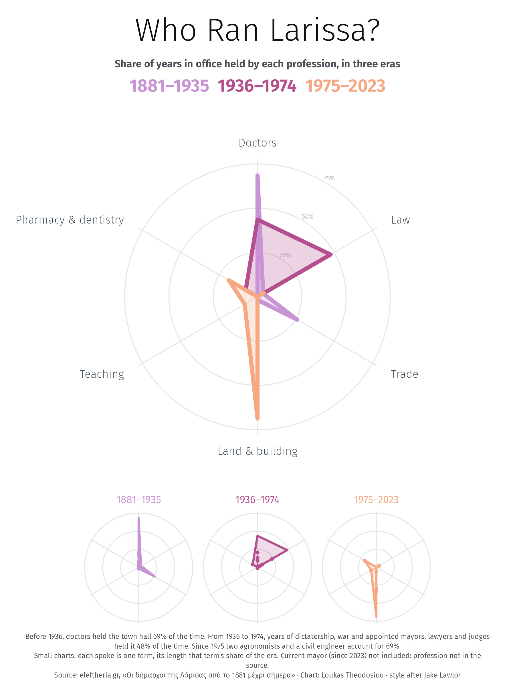](thessaly-dataviz/out/t11_mayor_professions_radar.png)
Code: [`scripts/t11_mayor_professions_radar.R`](thessaly-dataviz/scripts/t11_mayor_professions_radar.R) · Same data as above.

### Hellenic Parliament 1974–2023, seat share per party
[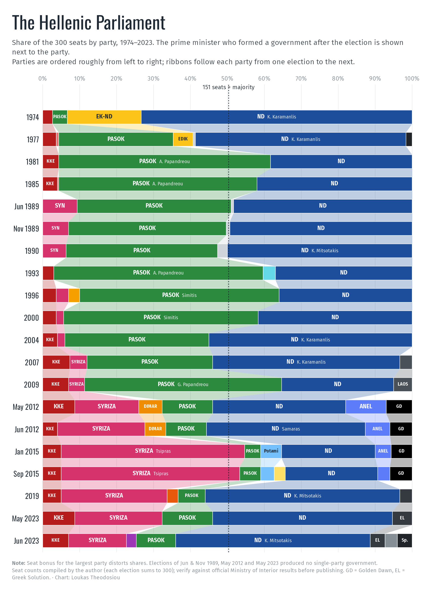](thessaly-dataviz/out/t4_greek_parliament.png)
Code: [`scripts/t4_greek_parliament.R`](thessaly-dataviz/scripts/t4_greek_parliament.R) · Seat counts still to be verified row by row against the Ministry of Interior before publishing.

## Wall exhibit, panel 17: the climate

### Annual mean temperature, Thessaly and Larissa, 1960–2024
[](Thessaly%20Infographic%20Installation/R/out/17-temperature.png)
Code: [`R/02-figures.R`](Thessaly%20Infographic%20Installation/R/02-figures.R) (`fig_temptime`), data fetched by [`R/fetch-openmeteo.R`](Thessaly%20Infographic%20Installation/R/fetch-openmeteo.R) · Data: ERA5-Land (Copernicus/ECMWF) via the Open-Meteo archive API. The printed panel is drawn from the same JSON by [`charts.js`](Thessaly%20Infographic%20Installation/charts.js); a proof is in [`R/out/panel17_preview.png`](Thessaly%20Infographic%20Installation/R/out/panel17_preview.png).

### Heat days at Larissa, 1960–2024
[](Thessaly%20Infographic%20Installation/R/out/17-heatdays.png)
Code: [`R/02-figures.R`](Thessaly%20Infographic%20Installation/R/02-figures.R) (`fig_heatdays`) · Data: daily ERA5-Land grid cell at Larissa. Not yet placed on the wall.

## Global data-journalism set

### Carbon Majors since Paris
[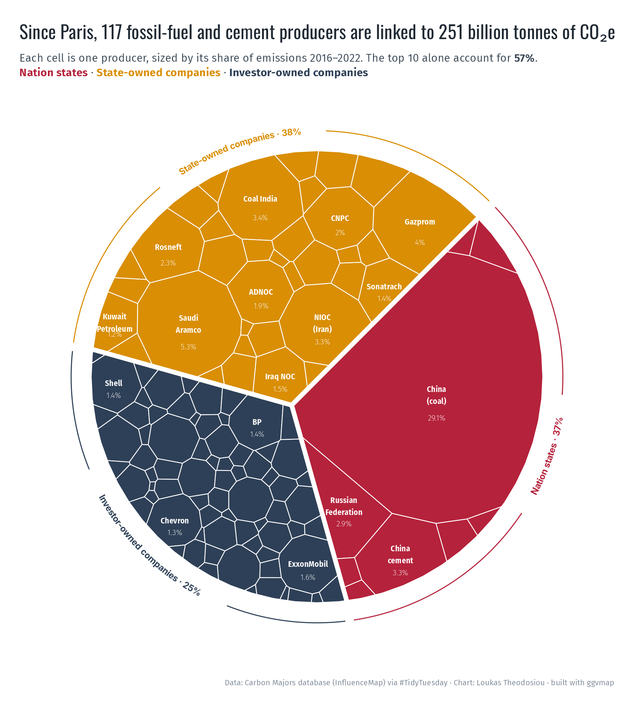](thessaly-dataviz/out/p1_carbon_majors.png)
Code: [`scripts/p1_carbon_majors.R`](thessaly-dataviz/scripts/p1_carbon_majors.R) · Data: Carbon Majors via TidyTuesday 2024-05-21. Drawn with [ggvmap](https://github.com/loukesio/ggvmap).

### Who owns the power behind AI
[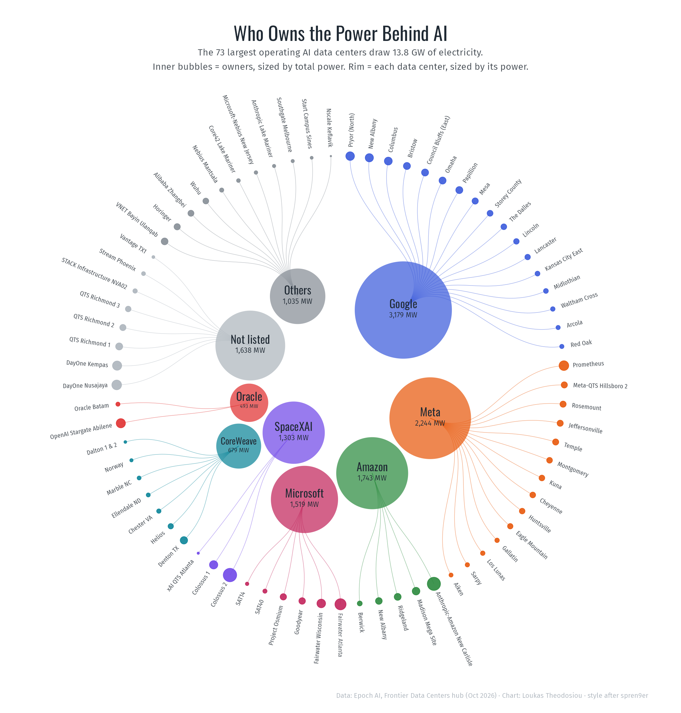](thessaly-dataviz/out/p2_ai_datacenters_fan.png)
Code: [`scripts/p2b_ai_fan.R`](thessaly-dataviz/scripts/p2b_ai_fan.R) using [`R/radial_fan.R`](thessaly-dataviz/R/radial_fan.R) · Data: Epoch AI frontier data centres. The ggvmap version is [`scripts/p2_ai_datacenters.R`](thessaly-dataviz/scripts/p2_ai_datacenters.R).

### Gini before vs after taxes, US vs Germany
[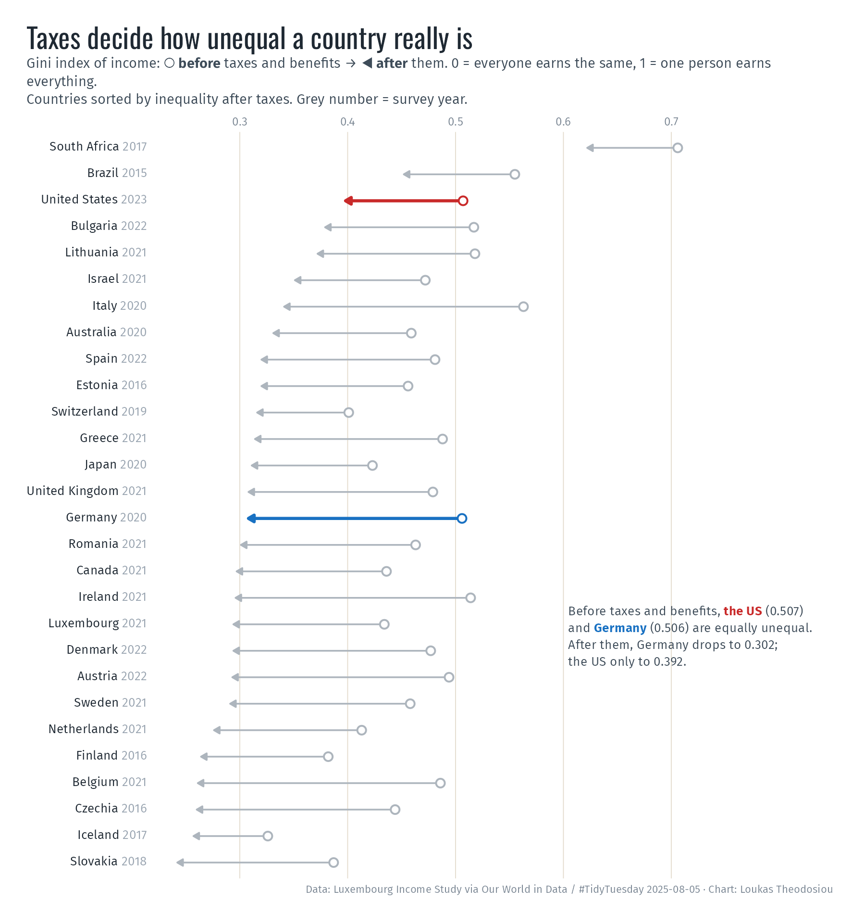](thessaly-dataviz/out/p3_redistribution.png)
Code: [`scripts/p3_redistribution.R`](thessaly-dataviz/scripts/p3_redistribution.R) · Data: OWID / LIS via TidyTuesday 2025-08-05. Marked for redesign.

### US imprisonment rate by race
[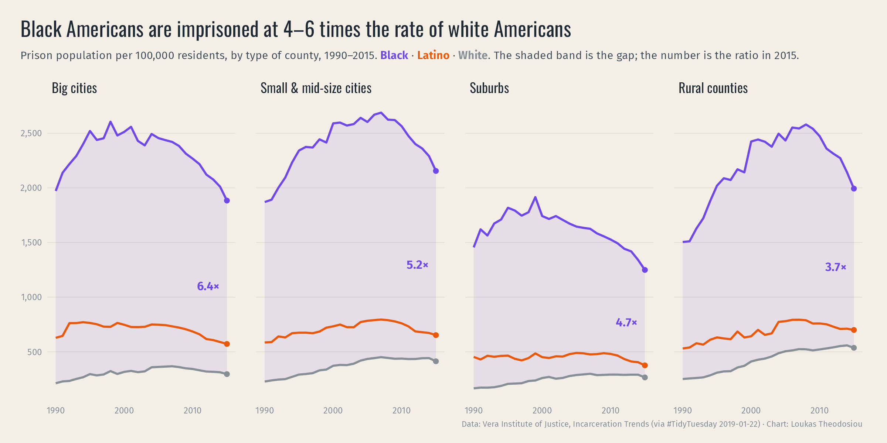](thessaly-dataviz/out/p4_incarceration.png)
Code: [`scripts/p4_incarceration.R`](thessaly-dataviz/scripts/p4_incarceration.R) · Data: Vera Institute via TidyTuesday 2019-01-22. Marked for redesign.

### Plant extinction by continent
[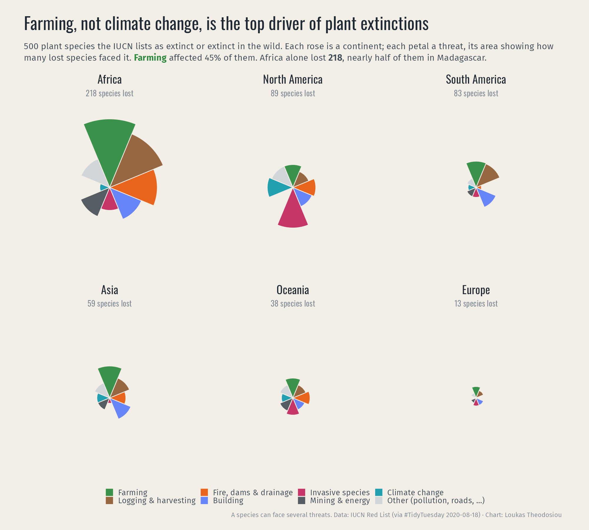](thessaly-dataviz/out/p5_plant_extinction.png)
Code: [`scripts/p5_plant_extinction.R`](thessaly-dataviz/scripts/p5_plant_extinction.R) · Data: IUCN via TidyTuesday 2020-08-18. Marked for redesign or removal.

## Not yet rendered

- Drought small multiples, [`scripts/t7_thessaly_drought.R`](thessaly-dataviz/scripts/t7_thessaly_drought.R): ERA5 download from Open-Meteo in progress (rate-limited).
- Europe protests vs armed violence, [`scripts/x1_europe_acled_map.R`](thessaly-dataviz/scripts/x1_europe_acled_map.R): needs an ACLED data export.

## Reproducing

```bash
cd thessaly-dataviz
Rscript setup/install_packages.R
Rscript setup/install_fonts.R      # Oswald, Fira Sans, Fira Sans Condensed, Playfair Display, Cormorant Garamond
Rscript scripts/<name>.R           # from the project root; large inputs are downloaded on first run
```

Fonts: Oswald, Playfair Display and IBM Plex Mono carry no Greek glyphs. Greek text uses Fira Sans here and IBM Plex Sans in the exhibit.
