# #30DayMapChallenge 2026 — Thessaly

Thirty maps of Thessaly and Larissa for the [#30DayMapChallenge](https://30daymapchallenge.com) of November 2026,
made in R / ggplot2 by Loukas Theodosiou. Every map is built from open data named in its caption; each title is a
number the script computes and prints. ✅ = done · ✋ = needs a check or input from Loukas (see *Status*).

Each day is one R file in `scripts/`; click a map to open its code.

**Run** from `thessaly-dataviz/`: `LANG=en_US.UTF-8 Rscript 30daymap/scripts/dayNN_<name>.R`. Scripts download and
cache their data in `30daymap/cache/` (not in git). Shared look and data helpers: [`R/m30_base.R`](R/m30_base.R)
(fonts Oswald + Fira Sans, Copernicus DEM, OSM extract, GADM municipalities). Design brief: [`BRIEF.md`](BRIEF.md).

| Day | Theme | Title | |
|---|---|---|---|
| 1 | [Points](#day-01) | Nearly a third of Thessaly's settlements sit above 500 m | ✅ |
| 2 | [Lines](#day-02) | Three fifths of Thessaly drains into one river | ✅ |
| 3 | [Polygons](#day-03) | Half of mapped Thessaly is fields | ✅ |
| 4 | [Clusters](#day-04) | Three places hold 44% of Thessaly's threatened-species records | ✅ |
| 5 | [Sight](#day-05) | Olympus sees 32% of Thessaly, Meteora only 6% | ✅ |
| 6 | [Vintage](#day-06) | 37% of Thessaly is plain, 16% is mountain | ✅ |
| 7 | [A 10 minute map](#day-07) | Fewer than a third of Larissa's streets keep to the compass | ✅ |
| 8 | [Utopia](#day-08) | Karla came back at a fifth of its size | ✋ |
| 9 | [Urban-rural](#day-09) | Half of Thessaly lives on 1% of its land | ✅ |
| 10 | [Prompting only](#day-10) | A sixth of Thessaly stands above 1,000 m, a ring of mountains around a flat plain | ✅ |
| 11 | [Sound](#day-11) | Thessaly on tape: 355 recordings, half of them grasshoppers | ✅ |
| 12 | [Power](#day-12) | 1,644 solar parks, 22 km² of panels | ✅ |
| 13 | [Interactions](#day-13) | Half of Thessaly's people live on 0.6 % of its land | ✅ |
| 14 | [A Borgesian map](#day-14) | The map of Larissa is still half in tatters | ✋ |
| 15 | [Inside out](#day-15) | Close the Vale of Tempe and Thessaly is a lake of 2,880 km² again | ✅ |
| 16 | [Collaborative map](#day-16) | 1,244 people built this map, 7 of them did half the work | ✅ |
| 17 | [Light & dark](#day-17) | Shortest day, one hour before sunset: 32% of Thessaly already lies in shadow | ✅ |
| 18 | [NULL](#day-18) | 36% of Thessaly has no resident at all | ✅ |
| 19 | [Smell](#day-19) | Sage rules the plain, mint and thyme the mountains | ✅ |
| 20 | [Hexagons](#day-20) | Half of Thessaly lives in 8 hexagons | ✅ |
| 21 | [OpenStreetMap](#day-21) | Volos, in 1,370 km of mapped road | ✅ |
| 22 | [Projections](#day-22) | Thessaly is 14,050 km². Web Mercator makes it 23,700, a far-side globe 3,310 | ✅ |
| 23 | [Taste](#day-23) | 27 protected foods and drinks carry a Thessaly address | ✋ |
| 24 | [Network](#day-24) | 42,400 km of road, 53% of it dirt track | ✅ |
| 25 | [Is this a map?](#day-25) | Half of Thessaly is trees, a quarter is fields | ✅ |
| 26 | [Water](#day-26) | Daniel flooded 926 km² of Thessaly | ✅ |
| 27 | [New tool](#day-27) | From the river to the gods: 2,815 m in 29 km | ✅ |
| 28 | [Feeling](#day-28) | 2 August 2021: the plain felt like 46 °C | ✅ |
| 29 | [Raster](#day-29) | 58% of Thessaly's plain is fields | ✅ |
| 30 | [Pen & paper](#day-30) | (title to be written by hand) | ✋ |

---

## Day 01 · Points — Nearly a third of Thessaly's settlements sit above 500 m

**R file:** [`scripts/day01_settlements.R`](scripts/day01_settlements.R)

[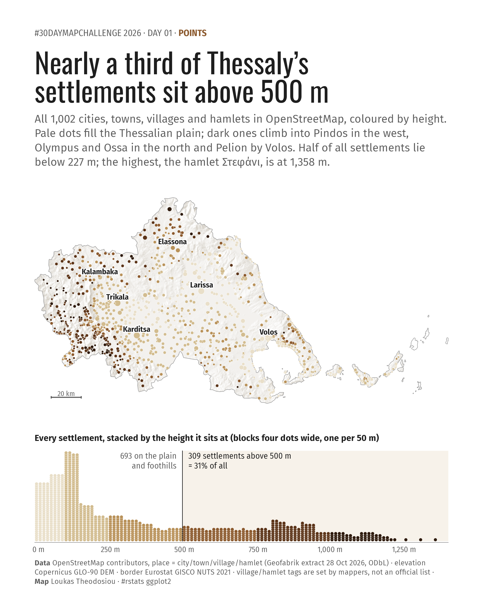](scripts/day01_settlements.R)

**Idea**
Every city, town, village and hamlet of Thessaly as one dot, coloured by the height it sits at. Pale dots fill the
plain, dark ones ring it in the mountains; a dot histogram below stacks all settlements by elevation.

**Data**
- OpenStreetMap, nodes with `place = city/town/village/hamlet`, Geofabrik Greece extract of 28 Oct 2026,
  https://download.geofabrik.de/europe/greece.html — ODbL. Compact copy: `30daymap/data/day01_settlements.csv`.
- Copernicus GLO-90 DEM, https://registry.opendata.aws/copernicus-dem/ — free licence (© DLR/Airbus, ESA).
- Border: Eurostat GISCO NUTS 2021 (EL61, with Sporades).

**How**
- `m30_osm("points", ...)` clipped to the region (incl. Sporades); DEM value sampled at every node (`terra::extract`).
- Six elevation classes, one brown sequential ramp; dot size by place type; faint multi-direction hillshade underneath.
- Dot histogram: 50 m bins, four dots wide; `patchwork`, `shadowtext`, `ggnewscale`.

**Finding**
1,002 settlements; 309 (30.8%) above 500 m; median elevation 227 m; villages + hamlets only: 31.9% above 500 m.
Highest: the hamlet Στεφάνι (W Pindos, 21.30 E 39.68 N), 1,358 m.

**Caveats**
- `village` vs `hamlet` is a mapper's choice, not the ELSTAT list of local communities; some abandoned or seasonal
  (summer) settlements may be tagged.
- Elevation = 90 m DEM cell under the OSM node (usually the village square).

**Status**
done

---

## Day 02 · Lines — Three fifths of Thessaly drains into one river

**R file:** [`scripts/day02_pineios_rivers.R`](scripts/day02_pineios_rivers.R)

[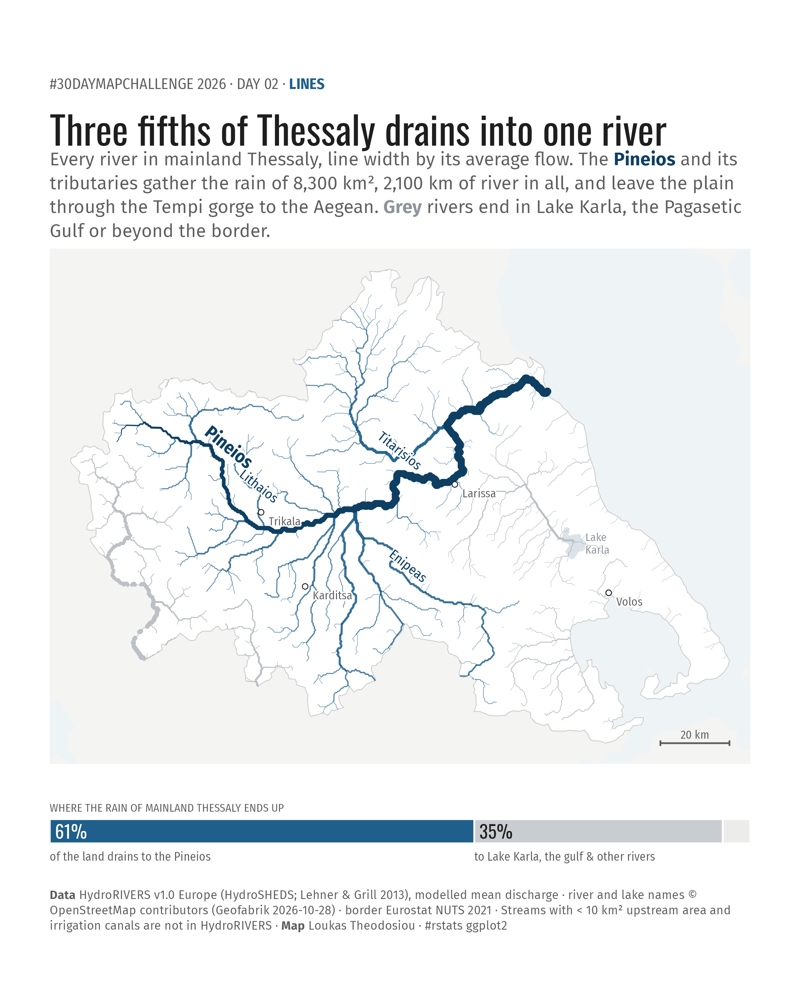](scripts/day02_pineios_rivers.R)

**Idea**
Every river reach of mainland Thessaly, line width by modelled mean discharge. The Pineios system is blue (main stem dark,
traced from the mouth at Tempi upstream along the largest upstream area); rivers that end in Lake Karla, the Pagasetic
Gulf or beyond the border are grey. A bar under the map gives the share of the region's land in each group.

**Data**
- HydroRIVERS v1.0 Europe, HydroSHEDS (Lehner & Grill 2013; Linke et al. 2019), CC BY 4.0 —
  https://www.hydrosheds.org/products/hydrorivers, file https://data.hydrosheds.org/file/HydroRIVERS/HydroRIVERS_v10_eu_shp.zip
  (cached in `30daymap/cache/osm_days/hydrorivers/`)
- River and lake names (Pineios, Enipeas, Titarisios, Lithaios, Lake Karla): OpenStreetMap, Geofabrik Greece extract
  2026-10-28, ODbL, © OpenStreetMap contributors
- Border: Eurostat GISCO NUTS 2021 (EL61), via m30_base.R

**How**
- Basin = HydroRIVERS `MAIN_RIV`; Pineios = the basin with most reaches inside Thessaly (id 20616961, mouth at Tempi).
- Main stem: walk upstream from the mouth, always taking the reach with the largest `UPLAND_SKM`.
- Basin area inside Thessaly = sum of `CATCH_SKM` of reaches whose midpoint lies inside the border.
- Tributary labels: OSM river lines buffered 1.5 km, matched to HydroRIVERS reaches; label angle from the local direction.
  Packages: sf, ggplot2, shadowtext.

**Finding**
- Mainland Thessaly 13,774 km²; Pineios basin inside it 8,348 km² = **60.6%** (other basins 35.5%, no mapped river 3.9%).
- Pineios at the mouth: 9,300 km² upstream area, 67.3 m³/s mean discharge (modelled).
- Pineios system: 445 reaches, **2,100 km** of river; main stem 206 km (HydroRIVERS geometry, 15 arc-second network).

**Caveats**
- HydroRIVERS keeps only reaches with ≥ 10 km² upstream area or ≥ 0.1 m³/s; irrigation canals and ditches of the plain
  are not in it, so the plain looks emptier than it is. Discharge is modelled natural flow (no abstraction for irrigation).
- Pineios basin area in HydroSHEDS (9,300 km²) may be smaller than published figures, which sometimes include the
  Karla basin (now drained by tunnel to the Pagasetic Gulf). Lake Karla is a separate basin here. Check against a
  published figure before quoting km² in text.
- Lengths come from a 15 arc-second (~500 m) grid network, so they are approximate.

**Status**
done

---

## Day 03 · Polygons — Half of mapped Thessaly is fields

**R file:** [`scripts/day03_thessaly_patchwork.R`](scripts/day03_thessaly_patchwork.R)

[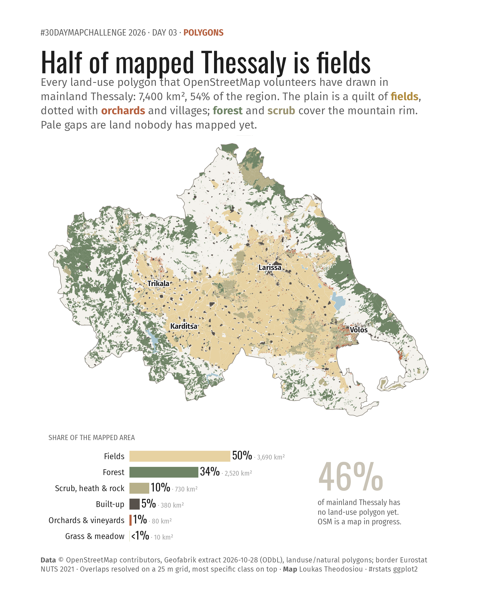](scripts/day03_thessaly_patchwork.R)

**Idea**
A mosaic of every land-use / land-cover polygon OpenStreetMap volunteers have drawn in mainland Thessaly, in six muted
earthy classes. Ranked bars give each class's share of the mapped area; a callout says how much is not mapped at all.

**Data**
OpenStreetMap, Geofabrik Greece extract 2026-10-28, © OpenStreetMap contributors, ODbL —
https://download.geofabrik.de/europe/greece.html (layer multipolygons in `30daymap/cache/thessaly_osm.gpkg`).
Border: Eurostat GISCO NUTS 2021 (EL61), mainland. Shares saved to `30daymap/data/day03_landuse_shares.csv`.

**How**
- Classes from `landuse` / `natural` tags (list in the script header); bare rock & scree merged into scrub & heath.
- Overlaps resolved on a 25 m grid (terra::rasterize), most specific class wins:
  Built-up > Orchards > Fields > Grass > Scrub > Forest.
- Polygons drawn with geom_sf, a white mask hides parts outside the border; bars as a patchwork inset.

**Finding**
- Mapped land use: 7,404 km² = 53.8% of mainland Thessaly (13,774 km²); 46% has no land-use polygon.
- Of the mapped area: fields 49.9% (3,692 km²), forest 34.0% (2,519), scrub/heath/rock 9.8% (726),
  built-up 5.1% (376), orchards & vineyards 1.1% (79), grass & meadow 0.2% (13).

**Caveats**
- Shares are of what OSM volunteers have drawn, not of the land: mapping effort is uneven (the plain and the Pindus
  forests are well covered, Agrafa and Othrys less). Not comparable to CORINE Land Cover.
- Orchards look small because many orchards are mapped as farmland or not at all.

**Status**
done

---

## Day 04 · Clusters — Three places hold 44% of Thessaly's threatened-species records

**R file:** [`scripts/day04_species_clusters.R`](scripts/day04_species_clusters.R)

[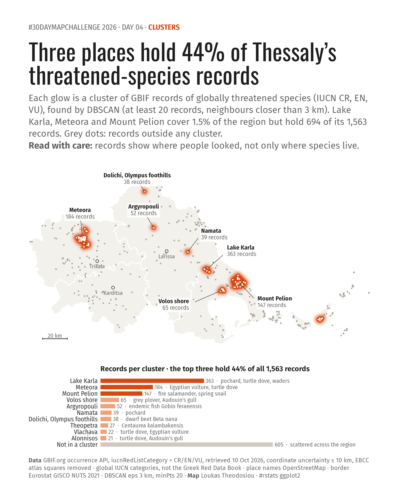](scripts/day04_species_clusters.R)

**Idea**
Instead of the hex grid of t13, let the records find their own hotspots: DBSCAN groups records of globally
threatened species that lie close together, and each cluster glows on the map, named after the place it sits on.

**Data**
- `data/gbif_thessaly_threatened.csv` (from `scripts/00_fetch_gbif_thessaly.R`), GBIF occurrence API,
  https://api.gbif.org/v1/occurrence/search, `iucnRedListCategory` = CR/EN/VU, retrieved 10 Oct 2026; licences per
  record (CC0 / CC BY / CC BY-NC). Same filter as t13 (uncertainty ≤ 10 km, EBCC atlas squares removed): 1,563 records.
- Cluster names: nearest OpenStreetMap place (Geofabrik 28 Oct 2026), checked against the dominant species.
  Table: `30daymap/data/day04_clusters.csv`.

**How**
- `dbscan::dbscan()` on EGSA87 metres, **eps = 3 km, minPts = 20**.
- Cluster shape = convex hull + 1.5 km buffer, `ggfx::with_outer_glow`; noise records as small grey dots.
- Ranked bar strip of the 10 clusters + "not in a cluster"; `patchwork`.

**Finding**
10 clusters hold 958 of 1,563 records (61%). The top three — Lake Karla 363, Meteora 184, Mount Pelion 147 = 694
records (44.4%) — cover 206 km², 1.5% of the region. Then Volos shore 65, Argyropouli 52, Namata 39,
Dolichi/Olympus foothills 38, Theopetra 27, Vlachava 22, Alonnisos 21.

**Caveats**
- Records show where people looked (iNaturalist users, birders, museum collections), not only where species live.
- Global IUCN categories as served by GBIF, not the Greek Red Data Book.
- Results depend on eps/minPts; with eps 2–4 km and minPts 15–25 the three biggest clusters stay the same
  (Lake Karla 354–381, Meteora 179–211, Pelion 95–161).
- "Argyropouli" and "Namata" are named after the nearest village; the records there are endemic fish
  (Gobio feraeensis) and pochard, i.e. a stream / wetland near that village.

**Status**
done

---

## Day 05 · Sight — Olympus sees 32% of Thessaly, Meteora only 6%

**R file:** [`scripts/day05_sight.R`](scripts/day05_sight.R)

[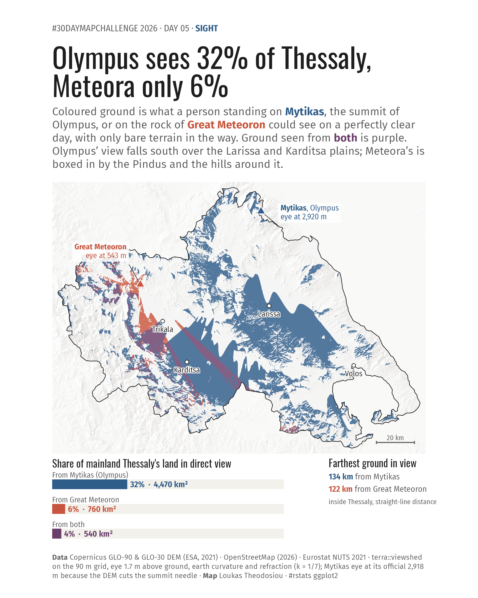](scripts/day05_sight.R)

**Idea**
Two viewsheds over mainland Thessaly: what a person standing on Mytikas (Olympus' summit) and on the rock of Great Meteoron could see on a perfectly clear day. Blue = seen from Olympus, red = seen from Meteora, purple = both. A bar strip gives the share of the land and the farthest visible ground.

**Data**
- Copernicus GLO-90 DEM (ESA/Airbus, 2021 release), https://copernicus-dem-90m.s3.amazonaws.com/ — licence: Copernicus DEM free licence (attribution).
- Copernicus GLO-30 DEM tiles N39 E021, N40 E022, https://copernicus-dem-30m.s3.amazonaws.com/ (observer heights only), same licence.
- OpenStreetMap, Geofabrik Greece extract 2026-10-28 (peak node "Μύτικας", polygon "Μονή Μεγάλου Μετεώρου"), ODbL.
- Eurostat GISCO NUTS 2021 (EL61), © EuroGeographics.

**How**
- `terra::viewshed()` on the 90 m DEM (region + 20 km), target 0 m, curvature + refraction `curvcoef = 6/7`.
- Mytikas eye = official 2,918 m + 1.7 m; Great Meteoron eye = GLO-30 top of the monastery polygon (541 m) + 1.7 m.
- Shares = visible land cells (DEM > 0) inside mainland Thessaly / all land cells (13,766 km²).
- ggplot2, tidyterra, shadowtext, ggtext.

**Finding**
- Visible from Mytikas: 32.4% (4,470 km²), farthest ground 134 km away.
- Visible from Great Meteoron: 5.6% (760 km²), farthest 122 km.
- From both: 4.0% (540 km²); from at least one: 34.0%.

**Caveats**
- Bare terrain only, no haze, trees or buildings: a best case.
- **Very sensitive to the summit height.** The DEMs cut the Mytikas needle (GLO-30 top 2,792 m, GLO-90 cell 2,768 m) and make neighbouring Skolio (DEM 2,899 m) look higher. With the DEM height as eye the share drops to 4.9%. The official 2,918 m was used; this is stated on the chart.
- The prompt's Meteoron coordinate (39.7217 N 21.6261 E) lies in the valley (330 m); the OSM monastery polygon (39.7267 N 21.6255 E) was used. The often quoted 613 m of the rock would see slightly more than the DEM's 541 m.
- Mytikas sits ~70 m outside the 1:1M region border; the view is computed over the whole DEM window.

**Status**
done

---

## Day 06 · Vintage — 37% of Thessaly is plain, 16% is mountain

**R file:** [`scripts/day06_vintage.R`](scripts/day06_vintage.R)

[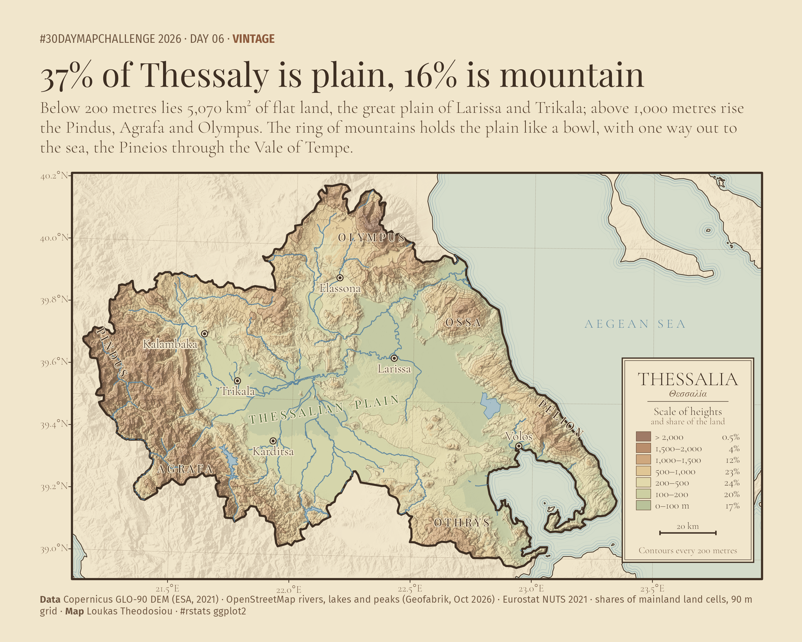](scripts/day06_vintage.R)

**Idea**
An old-atlas relief plate of Thessaly: faded hypsometric tints, 200 m contours, sepia relief shading, rivers in faded blue, engraved coast ripples and a serif cartouche with the "scale of heights" that doubles as the chart (share of the land in each height band).

**Data**
- Copernicus GLO-90 DEM (ESA/Airbus, 2021), https://copernicus-dem-90m.s3.amazonaws.com/ — Copernicus DEM licence.
- OpenStreetMap, Geofabrik Greece extract 2026-10-28, https://download.geofabrik.de/europe/greece.html — rivers (waterway = river), lakes Karla, Plastiras, Smokovo, positions of the peaks used for the range names — ODbL.
- Eurostat GISCO NUTS 2021 1:1M (border, coast), © EuroGeographics.

**How**
- Land cells of mainland Thessaly classified into 7 bands (0–100, 100–200, 200–500, 500–1,000, 1,000–1,500, 1,500–2,000, > 2,000 m); shares from `terra::freq()`.
- Contours from a 270 m smoothed copy (`terra::as.contour`), hillshade from `m30_hillshade()` rescaled to 0–1, coast ripples = buffers of the coastline.
- Playfair Display (title, range names), Cormorant Garamond (text), Fira Sans (Greek «Θεσσαλία»).

**Finding**
- Below 200 m: 36.7% of the land (5,070 km²); above 1,000 m: 16.4%. Total 13,809 km² of land cells.
- Bands: 0–100 m 17%, 100–200 20%, 200–500 24%, 500–1,000 23%, 1,000–1,500 12%, 1,500–2,000 4%, > 2,000 0.5%.

**Caveats**
- Mainland only (Sporades left out). GLO-90 is a surface model (tree and roof tops).
- Land total differs slightly from Day 05 (13,809 vs 13,766 km²) because Day 05 rasterises the border, Day 06 masks by it.
- Coast ripples and cartouche are decoration, not data. Cormorant italic/bold are not installed as separate faces, so plain weights are used.

**Status**
done

---

## Day 07 · A 10 minute map — Fewer than a third of Larissa's streets keep to the compass

**R file:** [`scripts/day07_larissa_streets.R`](scripts/day07_larissa_streets.R)

[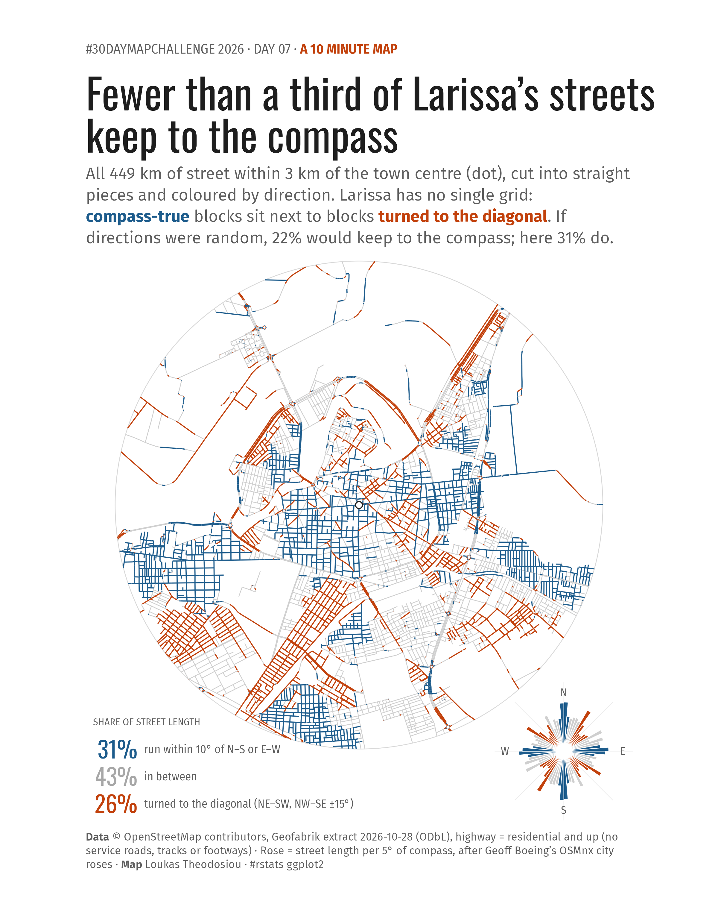](scripts/day07_larissa_streets.R)

**Idea**
Every street within 3 km of Larissa's centre, cut into straight pieces and coloured by how far it turns from the compass:
blue = runs N–S or E–W (±10°), rust = turned to the diagonal (NE–SW / NW–SE ±15°), grey = in between. A street
orientation rose (after Geoff Boeing's OSMnx city roses) shows length per 5° of compass.

**Data**
OpenStreetMap, Geofabrik Greece extract 2026-10-28, © OpenStreetMap contributors, ODbL —
https://download.geofabrik.de/europe/greece.html. Highway = motorway … residential, living_street, pedestrian
(no service roads, tracks, footways). Centre point from `m30_towns`.

**How**
- Lines clipped to a 3 km circle, split into vertex-to-vertex segments, bearing folded to 0–180° and weighted by length.
- Turn from compass = min(bearing mod 90, 90 − bearing mod 90).
- ggplot2 + coord_polar for the rose, patchwork insets.

**Finding**
- 449 km of street. Dominant bearings 178° and 88° (a compass-true grid).
- 30.7% of length within 10° of N–S/E–W (random would be 22%), 43.4% in between, 25.9% within 15° of a diagonal.

**Caveats**
- Bearings in EGSA87 grid; grid vs true north differ by < 1° here.
- Curved streets are split into many short pieces; each counts by its length.

**Status**
done

---

## Day 08 · Utopia — Karla came back at a fifth of its size

**R file:** [`scripts/day08_utopia_karla.R`](scripts/day08_utopia_karla.R)

[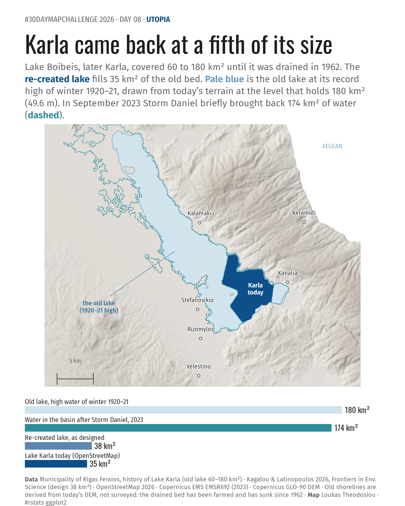](scripts/day08_utopia_karla.R)

**Idea**
Lake Karla (ancient Boibeis) was drained in 1962; a smaller lake was re-created in the lowest part of the old bed. The map puts the old lake at its record size next to today's lake — "the lake that was / the lake they want back" — and shows that Storm Daniel briefly refilled almost the whole old bed in September 2023.

**Data**
- Old lake size: Municipality of Rigas Feraios, history page «Λίμνη Κάρλα» — surface 60,000–180,000 stremmata (60–180 km²), largest ~180 km² in winter 1920–21; drainage works from 1956, final drainage 1962. https://www.rigas-feraios.gr/επισκεπτες/ιστορία/λίμνη-κάρλα/
- Re-created lake design: 38 km², mean depth ~2 m — Kagalou & Latinopoulos (2026), Frontiers in Environmental Science, doi:10.3389/fenvs.2026.1903658
- Today's lake: OpenStreetMap relation 12301781 (Geofabrik extract 2026-10-28), ODbL
- 2023 flood: Copernicus EMS Rapid Mapping EMSR692, observed flooded area, union of 28 products (6–22 Sep 2023), © EU
- Terrain: Copernicus GLO-90 DEM

**How**
- Old lake outline: level in today's DEM whose connected basin (seeded in today's lake) holds 180 km², found with `uniroot()` → 49.6 m; polygonised and smoothed (`smoothr`).
- 2023 water: EMS flood raster (20 m, built by day 26) inside the Karla basin (connected land below 60 m).
- terra, sf, ggplot2, patchwork, shadowtext.

**Finding**
Old lake at its 1920–21 high: 180 km² (source). Today's lake (OSM): 35.3 km² = 20% of it (5.1× smaller); designed 38 km². Storm Daniel water in the basin: 174 km² (EMS, 6–22 Sep 2023). DEM level holding 180 km²: 49.6 m.

**Caveats**
- No citable historic shoreline elevation was found (Wikipedia gives an uncited 60–80 m; papers give only areas). The outline is derived from today's DEM at the level that holds the documented area — an approximation, not a surveyed shoreline. The drained bed has been farmed and has subsided since 1962; GLO-90 is a 90 m surface model with the reservoir as a flat 45 m surface. Said on the chart.
- The documented low-water size (60 km²) could not be drawn: today's DEM already holds 67 km² at the reservoir's 45 m surface. Only mentioned in the subtitle.
- 174 km² flood is EMS pixels in the basin, depends on the basin definition (< 60 m connected); efsyn.gr (18 Sep 2023, Landsat-8, NOA/meteo.gr) reported ~190 km² on 16 Sep 2023 — same order.

**Status**
done (needs Loukas: OK with a DEM-derived old shoreline? If he has a historic map / survey level of the 1950s lake, swap it in).

---

## Day 09 · Urban-rural — Half of Thessaly lives on 1% of its land

**R file:** [`scripts/day09_urban_rural.R`](scripts/day09_urban_rural.R)

[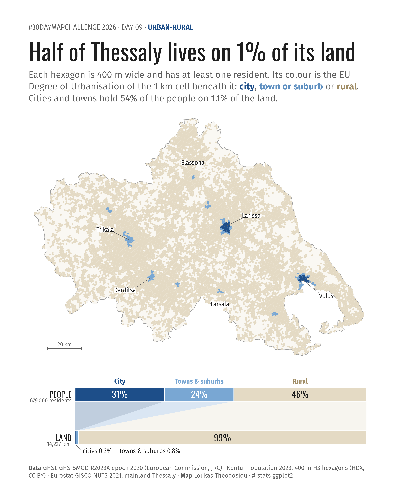](scripts/day09_urban_rural.R)

**Idea**
Every populated 400 m hexagon of mainland Thessaly, coloured by the EU Degree of Urbanisation of the 1 km cell under it
(city / town or suburb / rural). A paired ribbon bar puts the share of people next to the share of land.

**Data**
- GHSL GHS-SMOD R2023A, epoch 2020, 1 km Mollweide — European Commission JRC, CC BY 4.0.
  https://jeodpp.jrc.ec.europa.eu/ftp/jrc-opendata/GHSL/GHS_SMOD_GLOBE_R2023A/GHS_SMOD_E2020_GLOBE_R2023A_54009_1000/V2-0/GHS_SMOD_E2020_GLOBE_R2023A_54009_1000_V2_0.zip
  (cached in `30daymap/cache/day09/`)
- Kontur Population Greece 2023-11-01, 400 m H3 hexagons — HDX, CC BY 4.0. https://data.humdata.org/dataset/kontur-population-greece
- Eurostat GISCO NUTS 2021 EL61 (mainland) for the border.

**How**
- Each Kontur hexagon takes the SMOD class of the 1 km cell under its centre; people summed per class.
- Land = count of 1 km SMOD cells (equal-area, centre inside the region), water class excluded.
- Classes grouped the EU way: City = 30, Towns & suburbs = 21–23, Rural = 11–13.
- sf, terra, ggplot2, patchwork, shadowtext. Shares saved in `30daymap/data/day09_urban_rural_shares.csv`.

**Finding**
Cities + towns & suburbs: **54.5% of the people on 1.09% of the land** (155 of 14,227 km²).
City 30.7% of people on 0.3% of land; towns & suburbs 23.8% on 0.8%; rural 45.5% on 98.9%. Total 678,559 people.

**Caveats**
SMOD is modelled for 2020 (from GHS-POP), Kontur is 2023; grids do not line up exactly. 67 people in SMOD water cells
counted as rural. Only Larissa and Volos reach "urban centre" (class 30). Sporades excluded.

**Status**
done

---

## Day 10 · Prompting only — A sixth of Thessaly stands above 1,000 m, a ring of mountains around a flat plain

**R file:** [`scripts/day10_prompting_only.R`](scripts/day10_prompting_only.R)

[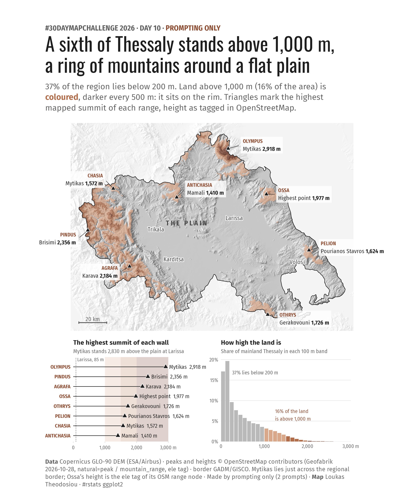](scripts/day10_prompting_only.R)

**Idea**
Thessaly is a lowland bowl walled in by mountains. The plain stays grey on a hillshade, land above 1,000 m is
coloured in one sienna ramp (darker every 500 m), and the highest mapped summit of eight ranges is labelled.
Below the map: those eight summits ranked, and a histogram of how much of the region lies in each 100 m band.

**Data**
- Copernicus GLO-90 DEM (ESA / Airbus, 2021 release), AWS open data — https://registry.opendata.aws/copernicus-dem/ — free licence with attribution.
- OpenStreetMap `natural=peak` and `natural=mountain_range` nodes with their `name`, `name:en` and `ele` tags,
  Geofabrik Greece extract 2026-10-28 — https://download.geofabrik.de/europe/greece.html — © OpenStreetMap contributors, ODbL.
- Region border: Eurostat GISCO NUTS 2021 (EL61) — https://gisco-services.ec.europa.eu/distribution/v2/nuts/ ; GADM 4.1 via `m30_base.R`.

**How**
- Made by prompting only: the code was written and rendered by an AI agent from prompts, with no hand edits. The
  prompts are in `30daymap/data/day10_prompt.txt` (2 prompts).
- The shared `thessaly_osm.gpkg` has no heights (GDAL's default `osmconf.ini` ignores `ele`), so the peak and range
  nodes were re-read from the cached `greece.osm.pbf` with a copy of `osmconf.ini` that keeps `ele` and `natural`
  (`sf::gdal_utils` vectortranslate, cached in `30daymap/cache/day10/peaks.gpkg`; 1,956 of 1,966 peaks have `ele`).
- For each OSM mountain_range node around the plain, I took the highest OSM peak with `ele` within ~10 km and checked it by hand.
  Shares come from the 90 m DEM cells inside the mainland border. Hillshade from `m30_hillshade()`, stretched to its 2–98% range.
- Packages: terra, sf, tidyterra, ggplot2, ggtext, ggnewscale, shadowtext, patchwork.

**Finding**
- 16.4% of mainland Thessaly lies above 1,000 m (39.4% above 500 m); 36.8% lies below 200 m.
- Mytikas (OSM ele 2,917.7 m) stands 2,833 m above Larissa (DEM 85 m at the town centre).
- Labelled summits (OSM node id): Olympus, Mytikas 2,917.7 m (354099249) · Pindus, Brisimi 2,356 m (2799721082) ·
  Agrafa, Karava 2,184 m (26864682) · Ossa 1,977 m (`ele` of the mountain_range node 14320697148) ·
  Othrys, Gerakovouni 1,726 m (26865152) · Pelion, Pourianos Stavros 1,624 m (26864354) ·
  Chasia, Mytikas 1,572 m (7274331195) · Antichasia, Mamali 1,410 m (353186717).

**Caveats**
- Heights are OSM `ele` tags as mapped, not DEM values.
- Ossa has no peak node with a height near its summit, so its 1,977 m is the `ele` of the OSM range node "Όσσα".
- Mytikas lies about 1 km outside the GISCO Thessaly border, on the Pieria side. It is shown because it tops the ring.
  The highest peak inside the border is Skolio, 2,905 m.
- Which range each peak belongs to comes from the nearest OSM range node or the peak's own OSM name, not from an official list.
  Brisimi sits on the Trikala–Arta border in the southern Pindus (Tzoumerka side).
- Mavrovouni (Magnesia) is in OSM as a range node, but the only peak tagged nearby is 400 m, so it is not labelled.
- English labels transliterate the OSM Greek name where `name:en` is missing.

**Status**
done. Loukas could check whether he prefers "Kissavos" for Ossa (OSM tags only "Όσσα"/"Ossa", so the map uses Ossa).

---

## Day 11 · Sound — Thessaly on tape: 355 recordings, half of them grasshoppers

**R file:** [`scripts/day11_sound.R`](scripts/day11_sound.R)

[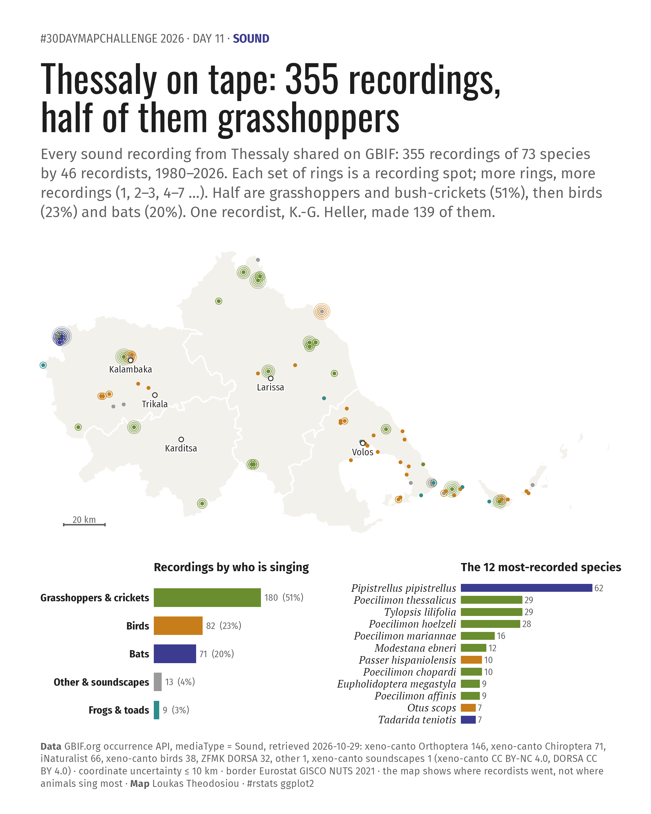](scripts/day11_sound.R)

**Idea**
Map every animal sound recorded in Thessaly and shared on GBIF, each spot drawn as concentric "sound rings" (more
rings = more recordings). Surprise: the soundscape on record is mostly bush-crickets and bats, not birds.

**Data**
- GBIF occurrence API, `mediaType=Sound`, bbox 21.1–24.4 E / 38.9–40.25 N, clipped to NUTS-2 EL61,
  retrieved 29 Oct 2026: https://api.gbif.org/v1/occurrence/search?mediaType=Sound — 1,314 in bbox, 357 inside
  Thessaly, 355 with uncertainty ≤ 10 km. Cache `30daymap/cache/gbif/day11_sound.rds`, compact `30daymap/data/day11_sound.csv`.
- Datasets: xeno-canto Orthoptera 146, xeno-canto Chiroptera 71, iNaturalist 66, xeno-canto birds 38,
  ZFMK DORSA (Bonn Orthoptera sound archive) 32, xeno-canto soundscapes 1, other 1.
  Licences: xeno-canto CC BY-NC 4.0, DORSA CC BY 4.0, iNaturalist CC BY-NC.
- Border: Eurostat GISCO NUTS 2021.

**How**
- Paged GBIF search API (`jsonlite`), cached; recordings snapped to a 1 km grid per group.
- Rings: 1 + floor(log2 n) circles per spot (1, 2–3, 4–7 … recordings), colour by animal group.
- Two bar strips (by group, top 12 species); `patchwork`, `shadowtext`.

**Finding**
355 recordings of 73 species by 46 recordists, 1980–2026. Grasshoppers & bush-crickets 180 (51%), birds 82 (23%),
bats 71 (20%), frogs 9, other 13. Most-recorded species: common pipistrelle (62). One recordist, K.-G. Heller,
made 139 (all Orthoptera).

**Caveats**
- Shows where recordists went (a few expert trips), not where animals sing most.
- xeno-canto birds are only partly in GBIF, so birds are under-represented vs. xeno-canto itself (its API needs a key, not used).
- Old DORSA recordings (1980s) can have approximate coordinates.

**Status**
done

---

## Day 12 · Power — 1,644 solar parks, 22 km² of panels

**R file:** [`scripts/day12_power.R`](scripts/day12_power.R)

[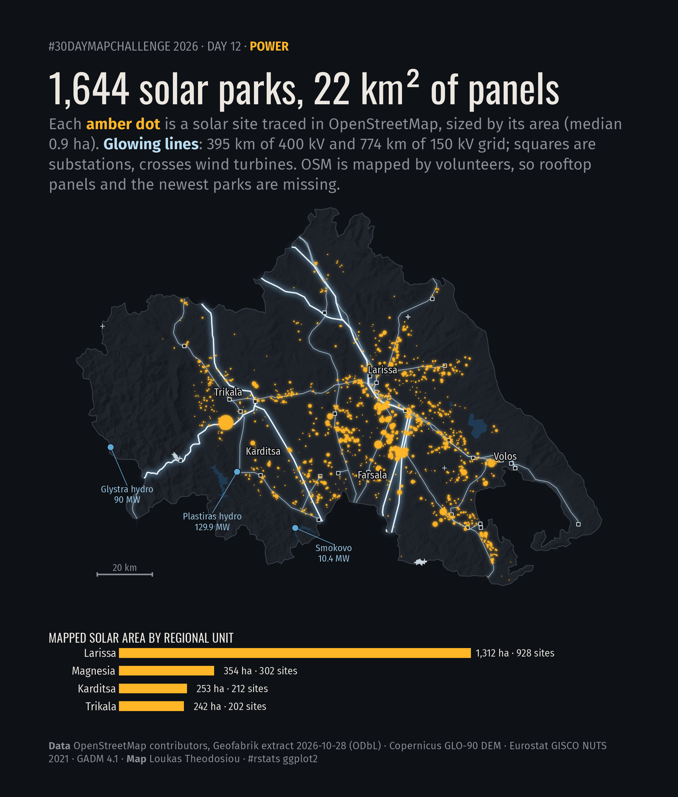](scripts/day12_power.R)

**Idea**
A night map of Thessaly's power: every solar site traced in OpenStreetMap as an amber dot (area to scale), the glowing
400 kV and 150 kV grid, substations, wind turbines and the three big hydro plants. Bars rank the regional units by
mapped solar area.

**Data**
- OpenStreetMap, Geofabrik Greece extract 2026-10-28, © OpenStreetMap contributors, ODbL.
  https://download.geofabrik.de/europe/greece.html (local `30daymap/cache/thessaly_osm.gpkg`; power subset cached in
  `30daymap/cache/day12/power.rds`). Tags: power=plant|generator (+ plant:source / generator:source),
  power=line|minor_line|cable (+ voltage), power=substation, generator:source=wind.
- Copernicus GLO-90 DEM (hillshade) · Eurostat GISCO NUTS 2021 EL61 (mainland) · GADM 4.1 (regional units).

**How**
- Solar plants are closed ways in the `lines` layer (GDAL's OSM config does not treat power=* as area) → cast to
  polygons; plus multipolygons. Solar site = solar plant + solar generator polygons that touch no plant.
- Area = area of the union (EGSA87). Grid lengths clipped to the border. Units by nearest GADM unit.
- ggplot2, sf, terra, ggfx (outer glow), patchwork, shadowtext. Unit table: `30daymap/data/day12_solar_by_unit.csv`.

**Finding**
**1,644 solar sites mapped (1,431 plants + 213 stand-alone arrays) on 21.6 km² (2,160 ha)**; median 0.9 ha, largest
71 ha (near Trikala). Larissa unit: 928 sites, 1,312 ha (61% of the area). Grid: 395 km of 400 kV, 774 km of 150 kV
inside the region; 35 substations; 30 wind turbines. Hydro (OSM capacity tags): Plastiras 129.9 MW, Glystra 90 MW,
Smokovo 10.37 MW.

**Caveats**
OSM completeness varies: field parks in Greece are well traced from imagery, rooftop PV is mostly absent, newest
parks lag. 1,416 of 1,431 solar plants have no capacity tag, so no MW total is claimed. 20 kV distribution is nearly
unmapped. "Glystra" is the plant name as tagged in OSM (Mesochora–Glystra scheme on the Acheloos) — Loukas may want to
check it. Sporades excluded.

**Status**
done

---

## Day 13 · Interactions — Half of Thessaly's people live on 0.6 % of its land

**R file:** [`scripts/day13_interactions.R`](scripts/day13_interactions.R) · [`out/day13_interactions.html`](out/day13_interactions.html)

[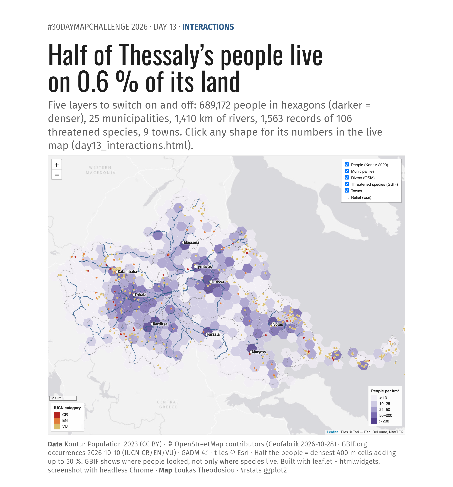](scripts/day13_interactions.R)

**Idea**
An interactive Leaflet map of Thessaly with five layers you can switch on and off: people (Kontur hexagons),
municipalities, OSM rivers, GBIF threatened-species records and the nine towns. Every shape has a popup with its
numbers. A framed screenshot of the live map is the social-media image; the title is a number computed from the data.

**Data**
- Kontur Population Greece 2023-11-01, 400 m H3 cells, CC BY 4.0 — https://data.humdata.org/dataset/kontur-population-greece
  (`data/kontur/kontur_population_GR_20231101.gpkg`).
- OpenStreetMap `waterway=river`, Geofabrik Greece extract 2026-10-28 — https://download.geofabrik.de/europe/greece.html — ODbL.
- GBIF occurrences of IUCN CR/EN/VU species in Thessaly, fetched 2026-10-10 (`data/gbif_thessaly_threatened.csv`,
  from `scripts/00_fetch_gbif_thessaly.R`, https://api.gbif.org/v1/occurrence/search) — CC0/CC BY per dataset.
- GADM 4.1 municipalities (25), Eurostat GISCO NUTS 2021 border. Base tiles: Esri World Gray Canvas / World Shaded
  Relief (free with attribution, no key).

**How**
- Kontur cells whose centre lies in Thessaly; cells summed to H3 resolution 6 (~36 km²) with `h3jsr` for the map;
  population per municipality by cell centroids.
- Finding: densest 400 m cells sorted and summed until they hold 50 % of the people; their area / region area.
- `leaflet` + `htmlwidgets::saveWidget(selfcontained = TRUE)` → `out/day13_interactions.html` (1.6 MB).
- Screenshot with `webshot2` (headless Chrome), framed with `m30_labs()` in ggplot2 (`annotation_raster`).

**Finding**
- 689,172 people (Kontur) on 14,053 km²; half of them live in 95 cells = 80 km² = **0.6 %** of the land.
- Layer counts: 417 populated hexagons, 25 municipalities, 1,410 km of OSM rivers (697 segments),
  1,563 GBIF records of 106 threatened species (fine coordinates only), 9 towns.

**Caveats**
- Kontur is a modelled grid (GHSL + buildings), not the census; the 0.6 % depends on the 400 m cell size
  (bigger cells would give a bigger share).
- OSM `river` includes some seasonal streams. GBIF shows where people looked, not only where species live;
  records with > 10 km uncertainty and the EBCC bird atlas are dropped (as in t13).
- CARTO tiles showed "API key required" when the HTML is opened from disk, so Esri tiles are used. The HTML needs
  internet for the base tiles; all data layers are inside the file.

**Status**
done

---

## Day 14 · A Borgesian map — The map of Larissa is still half in tatters

**R file:** [`scripts/day14_larissa_buildings.R`](scripts/day14_larissa_buildings.R)

[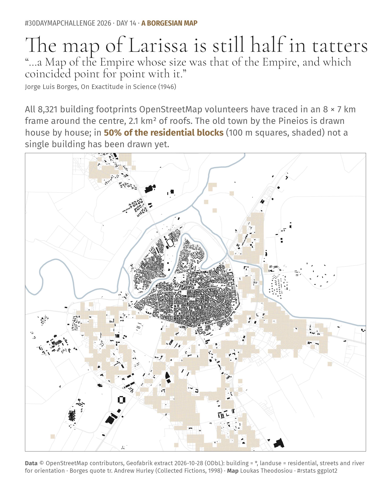](scripts/day14_larissa_buildings.R)

**Idea**
Borges' map that "coincided point for point" with the empire, applied to Larissa: every building footprint in OSM in an
8 × 7 km frame, in black ink. Where OSM marks residential land but no building has been traced, 100 m squares are
shaded — the parts of the map still in tatters.

**Data**
OpenStreetMap, Geofabrik Greece extract 2026-10-28, © OpenStreetMap contributors, ODbL —
https://download.geofabrik.de/europe/greece.html (building = *, landuse = residential, streets and river for context).
Quote: Jorge Luis Borges, "Del rigor en la ciencia" (1946), English tr. Andrew Hurley, Collected Fictions (1998).

**How**
- Buildings and residential polygons clipped to the frame; 100 m grid; a cell is "tatter" if its centre is in
  residential land use and it touches no building polygon.
- Title in Cormorant Garamond (vintage), quote via a registered font alias (gridtext cannot read spaced family names).

**Finding**
- 8,321 building footprints, 2.13 km² of roofs (3.8% of the 56 km² frame).
- 596 of 1,204 residential 100 m cells (49.5%) have no mapped building.

**Caveats**
- Blank = not traced yet, not empty. Residential land use itself is incompletely mapped, so the real gap is larger.
- Quote wording is from the Hurley translation as I know it; check it against the book before posting.

**Status**
needs Loukas: check the quote wording against Hurley's translation.

---

## Day 15 · Inside out — Close the Vale of Tempe and Thessaly is a lake of 2,880 km² again

**R file:** [`scripts/day15_inside_out.R`](scripts/day15_inside_out.R)

[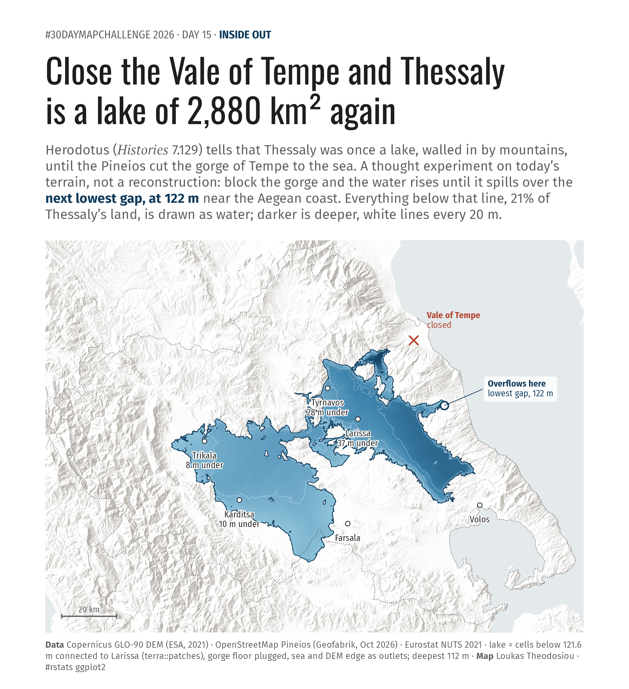](scripts/day15_inside_out.R)

**Idea**
Herodotus (Histories 7.129) writes that Thessaly was once a lake ringed by mountains until the Pineios cut the Tempe gorge. Thought experiment on today's terrain: plug the gorge, let the water rise until it finds the next way out, and draw the basin as water and the mountains as the land. Towns get their depth "under the lake".

**Data**
- Copernicus GLO-90 DEM (ESA/Airbus, 2021), https://copernicus-dem-90m.s3.amazonaws.com/ — Copernicus DEM licence.
- OpenStreetMap Pineios line (waterway = river, name = Πηνειός), Geofabrik extract 2026-10-28, ODbL.
- Eurostat GISCO NUTS 2021 1:1M (coast = outlet, region border), © EuroGeographics.
- Herodotus, Histories 7.129 (paraphrased on the chart).

**How**
- Outlets = sea cells (outside the NUTS land polygon) and the DEM window edge. Plug = Pineios between 22.545 E and 22.72 E, buffered 500 m, set to 5,000 m.
- Binary search on the water level; `terra::patches()` groups cells below the level; spill level = lowest level at which the patch with Larissa reaches an outlet. Lake = that patch just below it.
- Result cached in `30daymap/cache/terrain/day15_spill.rds` (delete to recompute, ~5 min).

**Finding**
- With the gorge open, Larissa (85 m) already drains to the sea at 85 m: no lake.
- With the gorge plugged, the water spills at **121.6 m**, at 22.787 E 39.688 N, the low gap east of the Karla basin towards the Aegean coast.
- Lake: 2,880 km² (2,833 km² inside Thessaly = 21% of its land), deepest 112 m. Larissa 37 m under, Tyrnavos 28 m, Karditsa 10 m, Trikala 8 m; Farsala, Volos, Kalambaka, Elassona stay dry.

**Caveats**
- A thought experiment on today's ground, not a reconstruction: the plain has been filled with river sediment for millennia and the gorge has deepened since. Said on the chart.
- The spill level depends on the 90 m DSM: a road cut, a narrow channel or tree canopy at the gap could shift it by a few metres. A first try with a plug drawn along the gorge (not across it) leaked and gave 110.6 m; the final plug covers the whole river line through Tempe.
- "Deepest 112 m" is just outside the plug at the gorge entrance, where today's river bed is lowest.

**Status**
done

---

## Day 16 · Collaborative map — 1,244 people built this map, 7 of them did half the work

**R file:** [`scripts/day16_inaturalist.R`](scripts/day16_inaturalist.R)

[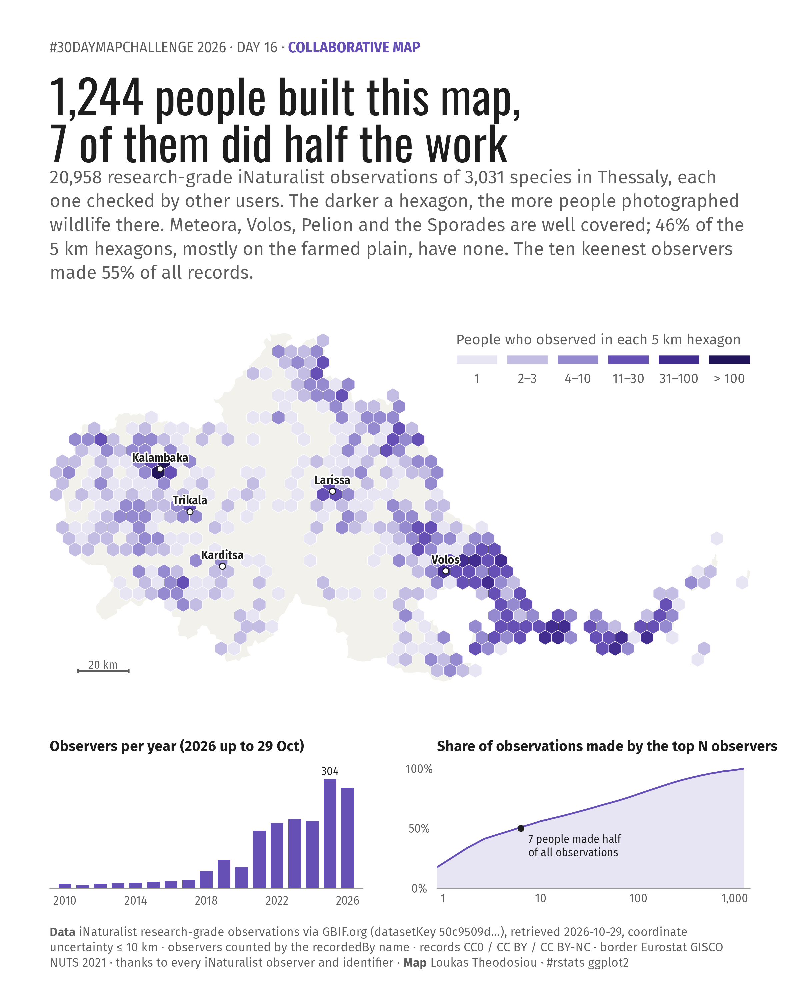](scripts/day16_inaturalist.R)

**Idea**
Thessaly's nature map as citizen science: every research-grade iNaturalist observation, binned into 5 km hexagons
coloured by how many different people observed there. Two small panels show the growth in observers per year and
how few people make most of the records.

**Data**
- iNaturalist Research-grade Observations via GBIF (datasetKey 50c9509d-22c7-4a22-a47d-8c48425ef4a7,
  https://www.gbif.org/dataset/50c9509d-22c7-4a22-a47d-8c48425ef4a7), GBIF occurrence API, retrieved 29 Oct 2026,
  bbox 21.1–24.4 E / 38.9–40.25 N then clipped to NUTS-2 EL61. Records CC0 / CC BY / CC BY-NC.
  Cache: `30daymap/cache/gbif/day16_inat.rds` (+ one file per year in `day16_inat/`); compact: `30daymap/data/day16_inat_hex5km.csv`, `day16_inat_years.csv`.
- Border: Eurostat GISCO NUTS 2021. No OSM data used.

**How**
- GBIF search API paged per year (deep offsets > ~20,000 take minutes per page, so the download is split by year
  and resumable); 48,130 in bbox → 23,508 inside Thessaly → 20,958 with uncertainty ≤ 10 km.
- 5 km hexagons (`st_make_grid`), distinct `recordedBy` per hexagon, six purple classes.
- Bars of observers per year; cumulative share of observations by observer rank (log x); `patchwork`, `shadowtext`.

**Finding**
20,958 observations of 3,031 species by 1,244 observers. 7 observers made half of all observations; the top 10
made 55%; 39% of observers made a single observation. Observers per year rose from 18 (2015) to 304 (2025);
279 so far in 2026. 46% of the 5 km hexagons have no observation; the busiest hexagon (Kalambaka/Meteora) has 349 observers.

**Caveats**
- Only research-grade records reach GBIF; casual observations are missing.
- recordedBy is a display name: one person with two accounts counts twice, a shared family account once.
- Obscured records of sensitive species (coordinates blurred by iNaturalist) mostly fall out with the 10 km filter (2,550 dropped).
- 2026 is a partial year (to 29 Oct).

**Status**
done

---

## Day 17 · Light & dark — Shortest day, one hour before sunset: 32% of Thessaly already lies in shadow

**R file:** [`scripts/day17_light_dark.R`](scripts/day17_light_dark.R)

[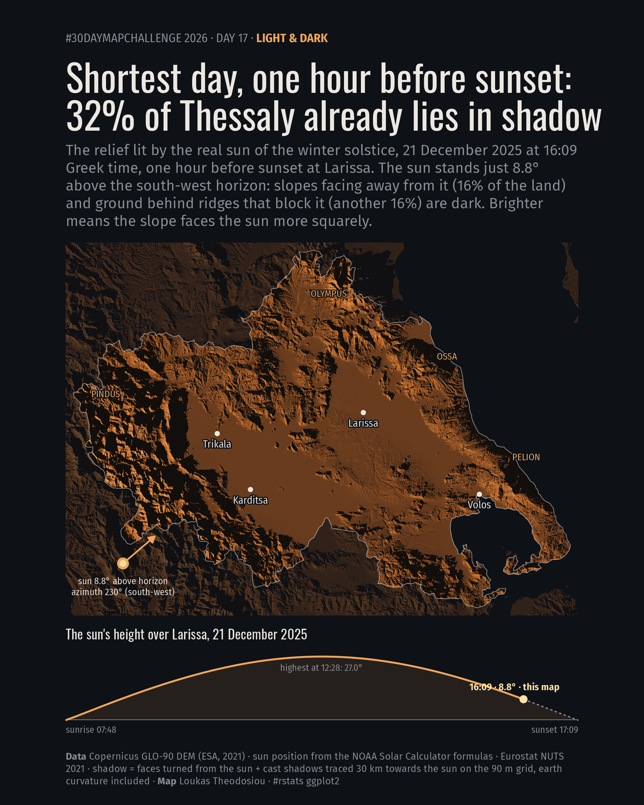](scripts/day17_light_dark.R)

**Idea**
Thessaly's relief lit by the real sun of the winter solstice, 21 December 2025 at 16:09 Greek time, one hour before sunset at Larissa. Warm light where slopes face the low south-west sun, ink where they face away or sit behind a ridge. A strip shows the sun's height through that day.

**Data**
- Copernicus GLO-90 DEM (ESA/Airbus, 2021), https://copernicus-dem-90m.s3.amazonaws.com/ — Copernicus DEM licence.
- Sun position: NOAA Solar Calculator formulas (Meeus), https://gml.noaa.gov/grad/solcalc/calcdetails.html, implemented in the script (no package needed; suncalc is not installed).
- Eurostat GISCO NUTS 2021 (EL61), © EuroGeographics.

**How**
- NOAA formulas at Larissa (39.639 N, 22.419 E): sunrise 07:48, sunset 17:09 EET (upper limb, −0.833°). Moment 16:09 EET = 14:09 UTC: apparent altitude 8.75°, azimuth 229.6°; noon maximum 27.0° at 12:28.
- Self-shadow: cosine of the incidence angle ≤ 0 (slope/aspect from `terra::terrain`).
- Cast shadow: own ray march, 30 km towards the sun in 90 m steps on the DEM matrix, curvature with refraction k = 1/7; shadow if any terrain rises above the sun ray. (Not `terra::shade`, which only gives self-shading.)
- ggplot2 dark theme (`theme_m30(dark = TRUE)`), shadowtext.

**Finding**
- 32.5% of mainland Thessaly's land is in shadow (4,470 of 13,766 km²): 16.1% slopes facing away, 16.4% more in cast shadow behind ridges.

**Caveats**
- One sun position for the whole region (computed at Larissa); across Thessaly the sun differs by less than 1°.
- Bare terrain; clouds, haze, trees and buildings ignored. Nearest-cell ray march on a 90 m grid.
- The solstice is the shortest day, not the earliest sunset (that is in early December); the title says "shortest day".

**Status**
done

---

## Day 18 · NULL — 36% of Thessaly has no resident at all

**R file:** [`scripts/day18_null.R`](scripts/day18_null.R)

[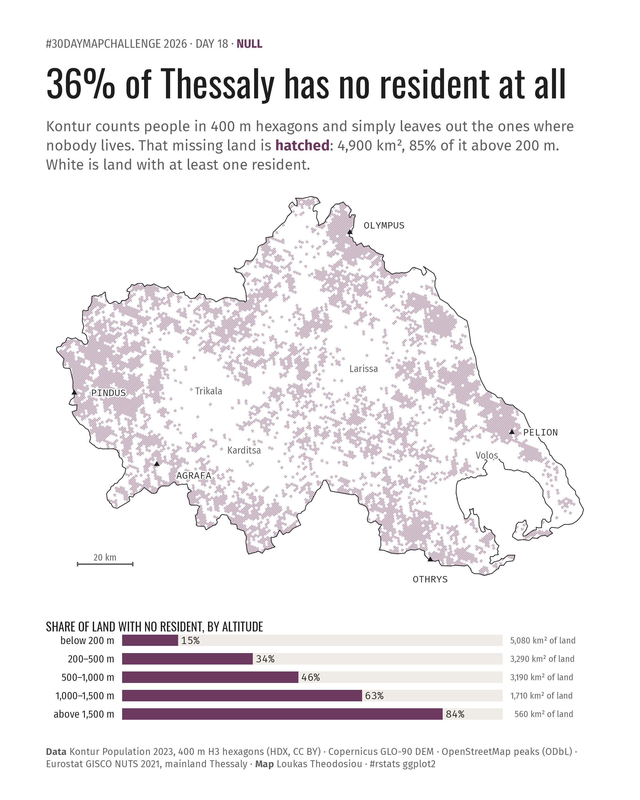](scripts/day18_null.R)

**Idea**
Kontur only lists 400 m hexagons with at least one person; the rest of the land is simply missing — NULL. The map
hatches that missing land, and a bar strip shows how the NULL share climbs with altitude.

**Data**
- Kontur Population Greece 2023-11-01, 400 m H3 hexagons — HDX, CC BY 4.0. https://data.humdata.org/dataset/kontur-population-greece
- Copernicus GLO-90 DEM (ESA/Copernicus, AWS open data, free licence) via `m30_dem()`.
- OpenStreetMap peaks (natural=peak), Geofabrik Greece extract 2026-10-28, ODbL — 5 massif labels at their highest named peak.
- Eurostat GISCO NUTS 2021 EL61, mainland.

**How**
- NULL land = mainland region polygon minus the union of all Kontur hexagons touching it (sf, EGSA87 areas).
- Hatch = 45° hairlines every 650 m clipped to the NULL polygon (hand-made, no ggpattern) over a pale tint.
- Elevation bands: NULL polygon rasterised on the 90 m DEM grid; share of cells per band
  (`30daymap/data/day18_null_by_elevation.csv`). sf, terra, ggplot2, patchwork, shadowtext.

**Finding**
**35.6% of mainland Thessaly (4,900 of 13,774 km²) has no resident in any 400 m hexagon.**
85% of the NULL land lies above 200 m. NULL share: 15% below 200 m, 34% at 200–500 m, 46% at 500–1,000 m,
63% at 1,000–1,500 m, 84% above 1,500 m.

**Caveats**
Kontur is modelled (GHSL, HRSL, building footprints, scaled to official totals): tiny hamlets or seasonal huts may be
missed or smeared. Border hexagons count whole. "No resident" is not "no use" — fields, pasture and forest are
there. Total here 687,921 people (hexagons touching the border); Day 09 uses hexagon centres (678,559).

**Status**
done

---

## Day 19 · Smell — Sage rules the plain, mint and thyme the mountains

**R file:** [`scripts/day19_herbs.R`](scripts/day19_herbs.R)

[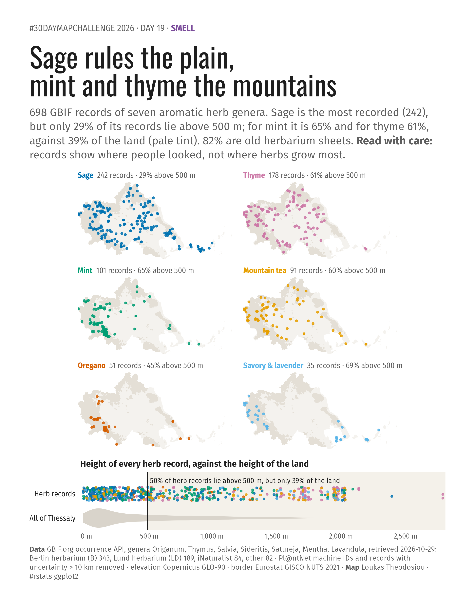](scripts/day19_herbs.R)

**Idea**
Thessaly's aromatic herbs — sage, thyme, mint, mountain tea, oregano, savory and lavender — as six small maps on a
tint of the land above 500 m, plus a strip comparing the height of every record with the height of the land.

**Data**
- GBIF occurrence API, one query per genus (`taxonKey` via /v1/species/match): Origanum 2926611, Thymus 2926960,
  Salvia 2926981, Sideritis 2926685, Satureja 2926882, Mentha 2927173, Lavandula 2927302; retrieved 29 Oct 2026,
  https://api.gbif.org/v1/occurrence/search?taxonKey=… ; cache `30daymap/cache/gbif/day19_*.rds`,
  compact `30daymap/data/day19_herbs.csv`.
- Datasets kept: Herbarium Berolinense Berlin 343 (CC0), Lund University herbarium 189 (CC BY-NC),
  iNaturalist 84 (CC BY-NC), other 82 (incl. ETH/Univ. Zurich herbaria, CC BY).
- Copernicus GLO-90 DEM; Eurostat GISCO NUTS 2021.

**How**
- 752 records inside Thessaly; Pl@ntNet automatic IDs and uncertainty > 10 km removed → 698.
- DEM sampled at each record; share above 500 m per genus vs. share of land above 500 m.
- `facet_wrap` small multiples, Okabe–Ito colours (colourblind-safe); jitter strip vs. violin of land elevation.

**Finding**
Sage (Salvia) most recorded: 242 records, 14 species, only 29% above 500 m. Thyme 178 (61% above 500 m),
mint 101 (65%), mountain tea 91 (60%), oregano 51 (45%), savory & lavender 35 (69%). All herbs: 50% above 500 m,
against 39% of the land. 82% of records are herbarium specimens.

**Caveats**
- Records show where botanists and app users looked; herbarium trips favoured Olympus, Pindos, Pelion.
- Salvia includes rosemary (S. rosmarinus, about 20 records, often planted) and weedy lowland sages (S. viridis, S. verbenaca).
- Satureja and Lavandula merged (few records).

**Status**
done

---

## Day 20 · Hexagons — Half of Thessaly lives in 8 hexagons

**R file:** [`scripts/day20_hexagons.R`](scripts/day20_hexagons.R)

[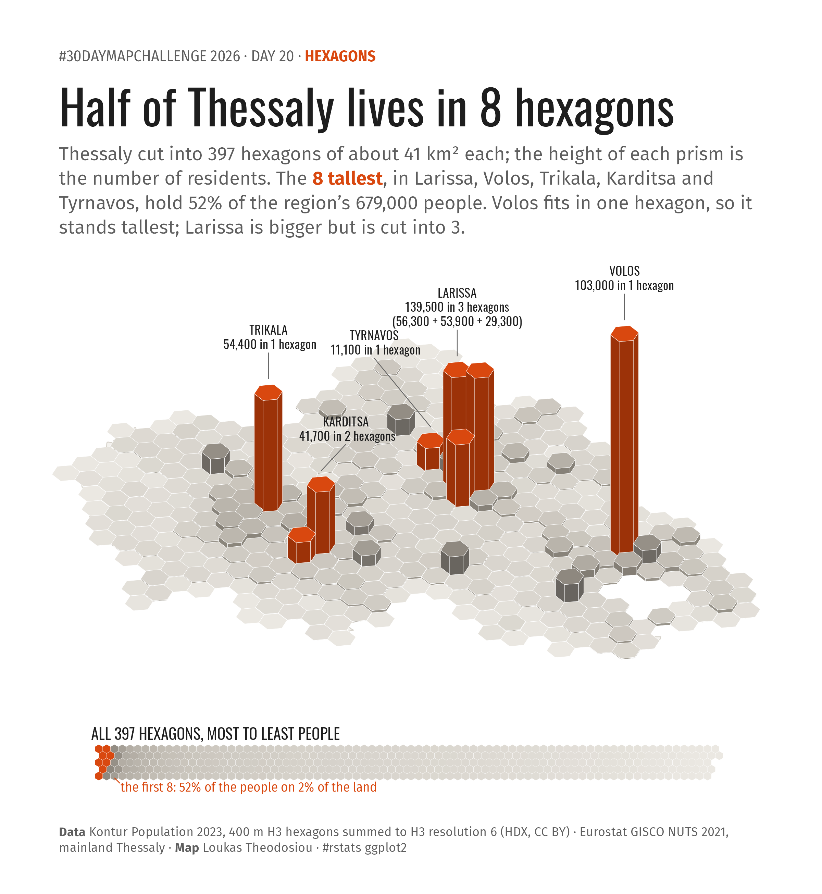](scripts/day20_hexagons.R)

**Idea**
Kontur's 400 m hexagons summed into 397 H3 resolution-6 cells (~41 km² each) and drawn as hexagonal prisms in a
hand-built oblique view, height = residents. The 8 tallest prisms, which together hold half of the people, are in
orange; a strip of all 397 cells ranked shows how fast the rest falls away. Different from t12: chunky H3 cells,
pure ggplot (no rayshader), one accent + greys.

**Data**
- Kontur Population Greece 2023-11-01, 400 m H3 hexagons (res 8) — HDX, CC BY 4.0.
  https://data.humdata.org/dataset/kontur-population-greece
- H3 grid (Uber, Apache 2.0) via h3jsr · Eurostat GISCO NUTS 2021 EL61, mainland.

**How**
- Res-8 hexagons with centre in mainland Thessaly → `h3jsr::get_parent(res = 6)` → summed
  (`30daymap/data/day20_h3res6_population.csv`).
- Oblique projection screen_y = 0.62·y + z, z linear in population; only south-facing walls drawn; painter's order
  north → south. All in ggplot2 polygons (no 3D engine), patchwork for the strip.
- Labels = nearest of the 9 base towns within 12 km of a top cell; population summed per town.

**Finding**
**8 of 397 res-6 hexagons hold 51.5% of 678,559 people on 2.0% of the hexagon area (329 of 16,317 km²).**
Volos 103,000 (one cell), Larissa 139,500 (3 cells: 56,300 + 53,900 + 29,300), Trikala 54,400, Karditsa 41,700 (2 cells), Tyrnavos 11,100. Volos is the tallest prism because the fixed H3 grid keeps it in one cell while it cuts Larissa into three; labels and subtitle say so.

**Caveats**
Kontur is modelled population (2023). Res-6 cells on the border stick out of the region, so the area base (16,317 km²)
is larger than the region (13,774 km²). Cell edges cut through towns (Larissa splits over 3 cells). The second
"Karditsa" cell (11,161 people) is the cell within 12 km of Karditsa, not necessarily the town itself. No rayshader
render was made — the hand-made ggplot prisms read more cleanly; a rayshader pass is possible if Loukas wants one.

**Status**
done

---

## Day 21 · OpenStreetMap — Volos, in 1,370 km of mapped road

**R file:** [`scripts/day21_volos_osm.R`](scripts/day21_volos_osm.R)

[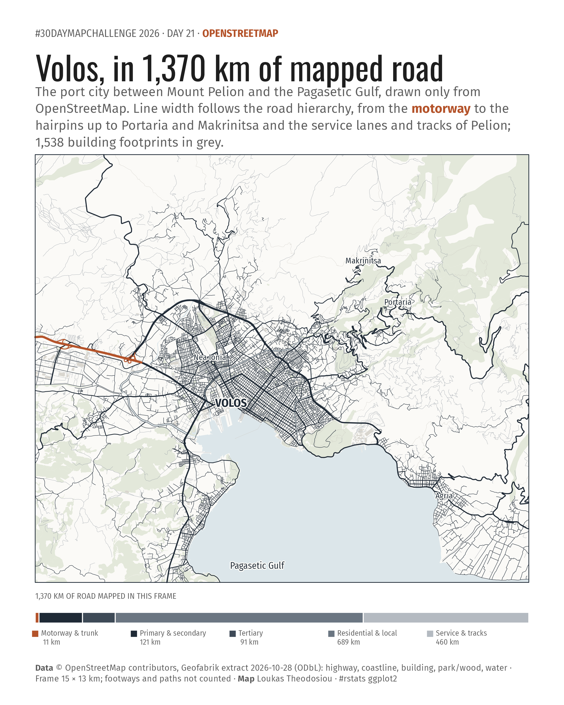](scripts/day21_volos_osm.R)

**Idea**
A poster of Volos between Mount Pelion and the Pagasetic Gulf from OpenStreetMap alone: sea, parks and woods, faint
building footprints, and every road with line width by its rank in the hierarchy (motorway in rust). A strip under the
frame splits the mapped road length by class.

**Data**
OpenStreetMap, Geofabrik Greece extract 2026-10-28, © OpenStreetMap contributors, ODbL —
https://download.geofabrik.de/europe/greece.html (highway, natural = coastline, building, leisure = park/garden,
landuse = forest, natural = wood/scrub/water, place nodes for labels).

**How**
- 15 × 13 km frame around 39.372 N, 22.958 E; land/sea by polygonising the OSM coastline with the frame edge
  (a face is land if a road crosses it).
- Road km = length of highway ways clipped to the frame (dual carriageways counted twice, as mapped).
- Place labels at OSM place nodes; only the "Pagasetic Gulf" label is placed by hand.

**Finding**
- 1,372 km of road in the frame: motorway & trunk 11 km, primary & secondary 121, tertiary 91,
  residential & local 689 (50%), service & tracks 460. Plus 108 km of footways/paths (not counted).
- Only 1,538 building footprints are mapped in the frame (Volos buildings are thinly traced in OSM).

**Caveats**
- Road length depends on how mappers split carriageways and link roads; it is "road mapped", not official network length.

**Status**
done

---

## Day 22 · Projections — Thessaly is 14,050 km². Web Mercator makes it 23,700, a far-side globe 3,310

**R file:** [`scripts/day22_projections.R`](scripts/day22_projections.R)

[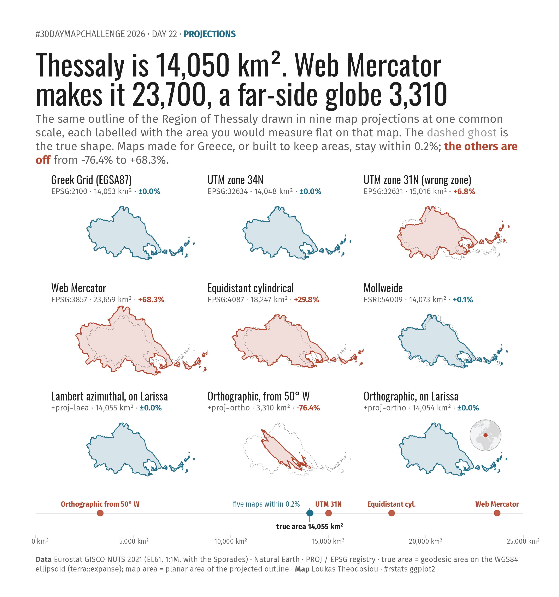](scripts/day22_projections.R)

**Idea**
The same outline of the Region of Thessaly (with the Sporades) drawn in nine projections at one common scale, each labelled with its EPSG/PROJ code and the area you would measure flat on that map. A dashed ghost shows the true shape; a dot strip puts all nine areas on one axis against the true area.

**Data**
- Eurostat GISCO NUTS 2021 1:1M, EL61, https://gisco-services.ec.europa.eu/distribution/v2/nuts/ — © EuroGeographics.
- Natural Earth 1:110m countries (globe locator), public domain, via rnaturalearth.
- Projection definitions: EPSG registry / PROJ.

**How**
- True area: geodesic area on the WGS84 ellipsoid, `terra::expanse()` on lon/lat (GeographicLib). (`lwgeom` is not installed, so `sf::st_area` on lon/lat was not used.)
- Map area: planar `st_area()` of the outline in each CRS. Shapes shifted to their centroid and drawn in metres on one scale.
- Projections: EGSA87 EPSG:2100, UTM 34N EPSG:32634, UTM 31N EPSG:32631 (wrong zone), Web Mercator EPSG:3857, World Equidistant Cylindrical EPSG:4087, Mollweide ESRI:54009, LAEA on Larissa, orthographic from 0° N 50° W, orthographic on Larissa (+ globe inset, not to scale).

**Finding**
- True area 14,055 km².
- Within 0.2%: EGSA87 14,053; UTM 34N 14,048; LAEA 14,055; orthographic on Larissa 14,054; Mollweide 14,073 (+0.1%).
- Off: UTM 31N 15,016 (+6.8%), equidistant cylindrical 18,247 (+29.8%), Web Mercator 23,659 (+68.3%), orthographic from 50° W 3,310 (−76.4%).

**Caveats**
- Areas are of the generalised 1:1M outline; the official area of Thessaly is about 14,036 km².
- PROJ's Mollweide uses a sphere with the WGS84 semi-major axis, hence +0.1% although equal-area.
- The "far-side globe" is an extreme on purpose: Thessaly near the edge of an orthographic view from over the Atlantic.

**Status**
done

---

## Day 23 · Taste — 27 protected foods and drinks carry a Thessaly address

**R file:** [`scripts/day23_taste.R`](scripts/day23_taste.R)

[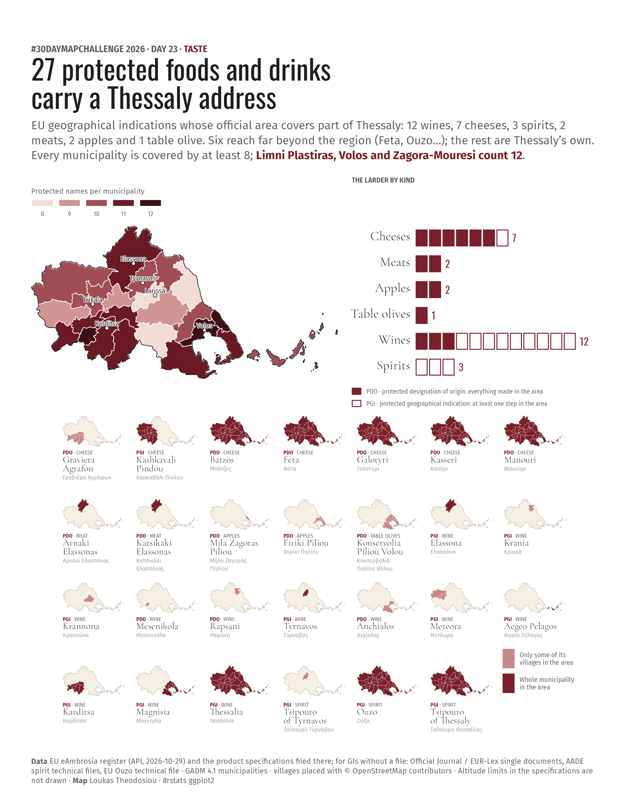](scripts/day23_taste.R)

**Idea**
Thessaly's larder as the EU sees it: every geographical indication (PDO / PGI) whose official area covers part of
the region. A count map (how many protected names reach each municipality), a strip of the larder by kind, and one
small "food label" map per product with its Latin and Greek name, type and category.

**Data**
- EU eAmbrosia register, read 2026-10-29 through its API: list `https://webgate.ec.europa.eu/eambrosia-api/api/geographical-indications?size=1000&page=0..3`
  (3,935 GIs, 286 Greek), details `.../api/v2/geographical-indications/<id>`, specification files `.../api/v1/attachments/<id>`.
  EU register data, free reuse (Commission reuse policy).
- Product areas typed into `30daymap/data/day23_gi_thessaly.csv` (one row per GI, with the area text, the municipalities,
  whole/part, and a source URL per row).
- For 7 GIs eAmbrosia has no file. Sources used instead: OJ C 222/2010, C 307/2010 and C 322/2010 (Firiki Piliou, Arnaki and
  Katsikaki Elassonas); Reg. (EU) 2024/2017 (Kashkavali Pindou); AADE technical files TF 13A and 14A (Tsipouro of Thessaly
  and of Tyrnavos); the EU Ouzo technical file; the 2025 ministry single document for the Tyrnavos wine (its eAmbrosia file
  is a broken conversion). EUR-Lex, minagric.gr and aade.gr block scripts, so these were read from web-search excerpts.
- GADM 4.1 municipalities; villages named in the specifications placed with OSM place nodes (Geofabrik 2026-10-28, ODbL).

**How**
- Downloaded the specification of all 237 Greek GIs that have a file, extracted the text (pdftools), and searched it,
  accents removed, for Thessaly place names. The 27 hits were read by hand. All other hits were only passing mentions,
  e.g. "University of Thessaly" or rainfall at Larissa.
- Two specifications are in a broken Greek font encoding (Rapsani) or have no text layer. Rapsani was decoded by hand
  from the garbled text: Rapsani, Pyrgetos and Ampelakia.
- Village-level areas are drawn as their municipality in a lighter red ("only some villages"). Former provinces that
  cannot be mapped (Volos province for the olives, the 74 Agrafa villages) are drawn as the regional unit, light.
- ggplot2 + patchwork + ggtext; Cormorant Garamond for the label names, Fira Sans for the Greek.

**Finding**
- **27 GIs** touch Thessaly: 12 wines (3 PDO, 9 PGI), 7 cheeses (6 PDO, 1 PGI), 3 spirits (PGI), 2 meats, 2 apples,
  1 table olive (all PDO).
- Every municipality is covered by at least 8. Limni Plastira, Volos and Zagora-Mouresi are covered by 12 each, the most.
- 6 of the 27 reach far beyond the region: Feta, Kasseri, Manouri, Batzos, Galotyri and Ouzo.

**Caveats**
- "Touches" means at least part of the specified area lies in Thessaly. Ouzo covers all of Greece and Cyprus, and the
  Thessalia wine PGI covers the whole region, so every municipality starts from a high base.
- Kallikratis municipalities are bigger than the villages in the specifications. Altitude limits are not drawn.
- The areas of 7 GIs come from excerpts, not from the full official text (see Data). They are worth checking by hand:
  Tyrnavos wine, Tsipouro of Tyrnavos ("historical Tyrnavos area"), Kashkavali Pindou, Firiki Piliou, Arnaki and
  Katsikaki Elassonas, Tsipouro of Thessaly.
- Katiki Domokou (Fthiotida) has a scanned specification with no text layer. It is not counted.
- GADM places Gomfoi in Pyli, but the Graviera Agrafon specification puts it in Karditsa prefecture. That shows the
  GADM borders are approximate.

**Status**
done. Needs Loukas only to spot-check the 7 areas that come from excerpts (list above).

---

## Day 24 · Network — 42,400 km of road, 53% of it dirt track

**R file:** [`scripts/day24_network.R`](scripts/day24_network.R)

[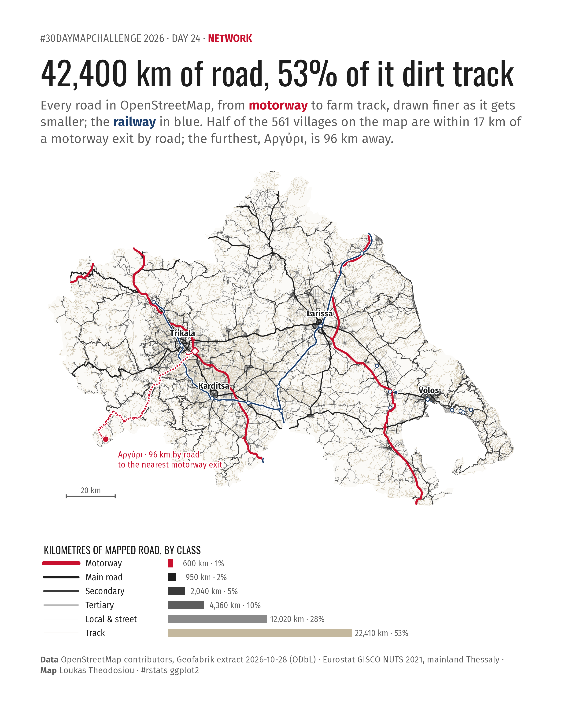](scripts/day24_network.R)

**Idea**
Every OSM road of mainland Thessaly drawn as a hierarchy — motorway in red, then ever finer greys down to farm
tracks — with the railway in blue and the dotted route from the village furthest (by road) from any motorway exit.
A bar key gives the kilometres per class.

**Data**
- OpenStreetMap, Geofabrik Greece extract 2026-10-28, © OpenStreetMap contributors, ODbL.
  https://download.geofabrik.de/europe/greece.html (local `30daymap/cache/thessaly_osm.gpkg`, subset in
  `30daymap/cache/day24/roads.rds`): highway=*, railway=rail, railway=station, highway=motorway_junction, place=village.
- Eurostat GISCO NUTS 2021 EL61, mainland.

**How**
- km per class = OSM way length clipped to the region (EGSA87) → `30daymap/data/day24_road_km_by_class.csv`.
- Road graph (igraph): all non-track roads (no service roads, tracks, paths), split at every OSM vertex, joined where
  coordinates coincide; largest connected piece kept (749k nodes).
- Dijkstra from the 93 motorway exits inside the region to all 561 OSM villages (snapped to the nearest node; snap
  distance added) → `30daymap/data/day24_village_exit_km.csv`.
- ggplot2, sf, igraph, patchwork, shadowtext.

**Finding**
**42,368 km of mapped road, 22,414 km (53%) tracks.** Motorway 596 km, main roads 950, secondary 2,035, tertiary 4,356,
local & streets 12,017. Median village: **17 km** by road to a motorway exit; furthest **Αργύρι (Argithea, Karditsa)
96 km**, then Γριμπιανά 90 and Μυρόφυλλο 85; 32 villages are more than 50 km away.

**Caveats**
OSM tagging and track mapping are uneven. Dual carriageways are two OSM ways, so motorway (and some main-road) km
count both directions. Routing ignores one-ways and turn rules; exits just outside the border (A1 in Phthiotis, A2
Egnatia beyond the border) are not counted, so a few southern/north-western villages may be a bit closer in reality.
Only place=village nodes (not hamlets).

**Status**
done

---

## Day 25 · Is this a map? — Half of Thessaly is trees, a quarter is fields

**R file:** [`scripts/day25_is_this_a_map.R`](scripts/day25_is_this_a_map.R)

[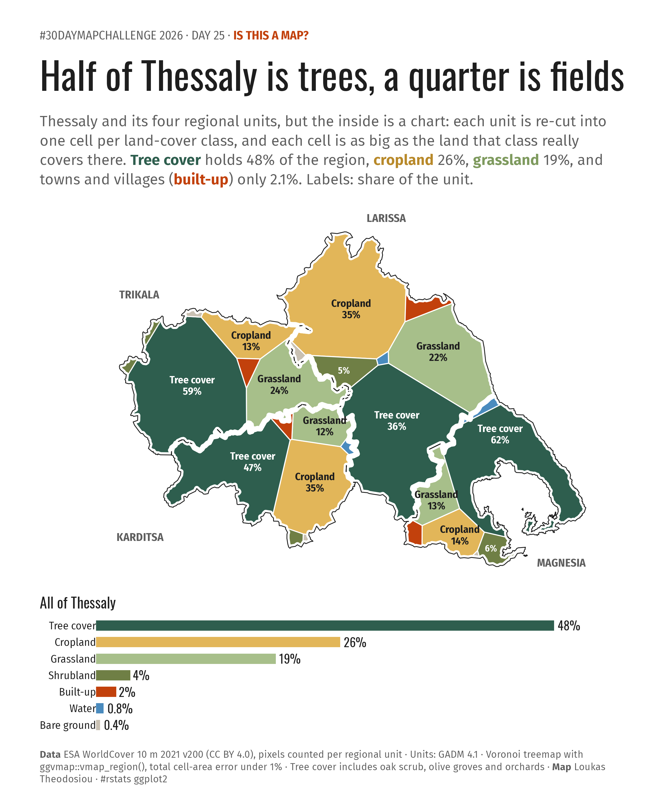](scripts/day25_is_this_a_map.R)

**Idea**
A chart that is also a map: the outline of Thessaly and its four regional units is real, but inside each unit the land is re-cut into a Voronoi treemap with one cell per land-cover class. Each cell's area is the real area of that class in that unit. Built with Loukas's own package ggvmap (`vmap_region()`), as the coordinator asked (replaces the waffle idea).

**Data**
ESA WorldCover 10 m 2021 v200, tiles N39E021 + N36E021, CC BY 4.0 (© ESA WorldCover project 2022 / contains modified Copernicus Sentinel data 2021). https://esa-worldcover.s3.eu-central-1.amazonaws.com/v200/2021/map/ESA_WorldCover_10m_2021_v200_N39E021_Map.tif — pixel counts per unit saved in `30daymap/data/day25_worldcover_units.csv`. Units: GADM 4.1 municipalities dissolved (`m30_units()`, mainland).

**How**
- `terra::crosstab()` of the 10 m class raster × rasterised regional units (all ~208 million pixels counted).
- One `ggvmap::vmap_region()` fit per unit (unit polygon simplified to 150 m, seed 25); all four converged (convergence 0.18–0.50% of area, 31–102 iterations). No errors from vmap_region.
- Drawn with `vm_as_df()` + `geom_polygon(subgroup = ring, rule = "evenodd")`; labels at each cell's deepest interior point; ranked bars of Thessaly totals as the key.

**Finding**
Mainland Thessaly: tree cover 48.3%, cropland 25.8%, grassland 19.0%, shrubland 3.6%, built-up 2.1%, water 0.8%, bare 0.4%. Cropland per unit: Larissa 35%, Karditsa 35%, Magnesia 14%, Trikala 13%.

**Caveats**
- Pixels counted in EPSG:4326 (area varies < 2% across Thessaly's latitudes; shares only).
- WorldCover "tree cover" = canopy ≥ 10%: includes oak scrub, olive groves, orchards — this is why it is 48%. Said in the caption.
- Wetland (0.03%) merged into water. Cell positions inside a unit are arbitrary; only areas carry data.
- For ggvmap (Loukas's package): `vmap_region()` worked first time on GADM units; `vm_centroids(inside = TRUE)` put a label in the Pagasetic gulf hole of Magnesia's tree-cover cell, so a pole-of-inaccessibility label point was computed in the script instead — possible package improvement.

**Status**
done

---

## Day 26 · Water — Daniel flooded 926 km² of Thessaly

**R file:** [`scripts/day26_water_daniel_flood.R`](scripts/day26_water_daniel_flood.R)

[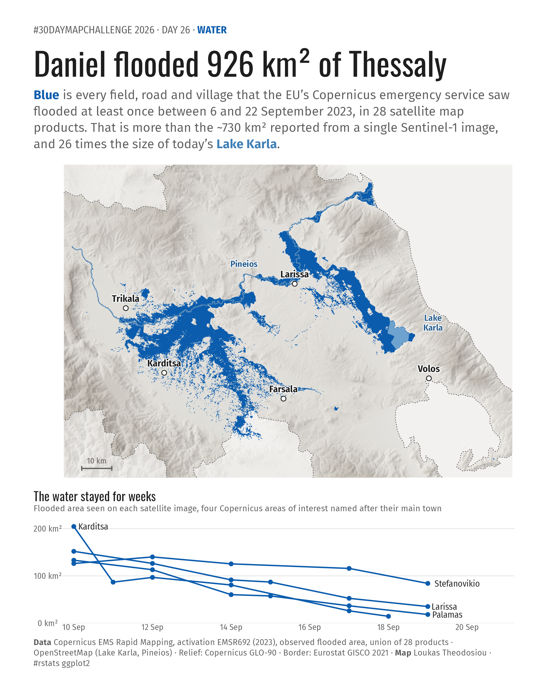](scripts/day26_water_daniel_flood.R)

**Idea**
Every patch of land that the EU's Copernicus emergency service saw under water at least once after Storm Daniel, over the relief of the plain with the Pineios and Lake Karla. A strip shows how slowly the water went down in the four big mapped areas.

**Data**
Copernicus EMS Rapid Mapping, activation EMSR692 "Flood in Greece" (event 5 Sep 2023): 28 vector products (DEL_PRODUCT + DEL_MONIT01–05) for 7 AOIs, layer `observedEventA`, notation "Flooded area"; images 6–22 Sep 2023. https://rapidmapping.emergency.copernicus.eu/EMSR692 (API: .../backend/dashboard-api/public-activations/?code=EMSR692). © European Union, Copernicus EMS, free use with attribution. OSM (Karla, Pineios), Copernicus GLO-90, Eurostat GISCO 2021.

**How**
- Script downloads the activation JSON and all zip packages (S3 redirect), cached in `30daymap/cache/emsr692/`.
- Union of all "Flooded area" polygons by rasterising at 20 m (vector `st_union` of 15,000 polygons was too slow); area = pixel count × 400 m².
- Receding strip: flooded km² per product date for AOIs with ≥ 4 dates.

**Finding**
926 km² flooded at least once 6–22 Sep 2023 (913 km² inside mainland Thessaly). EMS's own activation statistic "max_extent" = 933 km² (agrees). Press figure 730 km² (single Sentinel-1 image). = 26× today's Lake Karla (35 km²). "Flood trace" areas (mud/wet soil, not counted) add ~613 km² more. Receding: Karditsa AOI 204 km² (10 Sep) → 15 km² (18 Sep); Stefanovikio (Karla) 126 → 84 km² (19 Sep), slowest.

**Caveats**
- Union over 17 days and different sensors: no single moment had 926 km² under water.
- AOIs cover the plain and Pelion, not every corner of the region; cloud gaps on some dates.
- AOI dates differ, so the strip compares each AOI with itself.

**Status**
done

---

## Day 27 · New tool — From the river to the gods: 2,815 m in 29 km

**R file:** [`scripts/day27_new_tool.R`](scripts/day27_new_tool.R) · [`out/day27_new_tool.html`](out/day27_new_tool.html)

[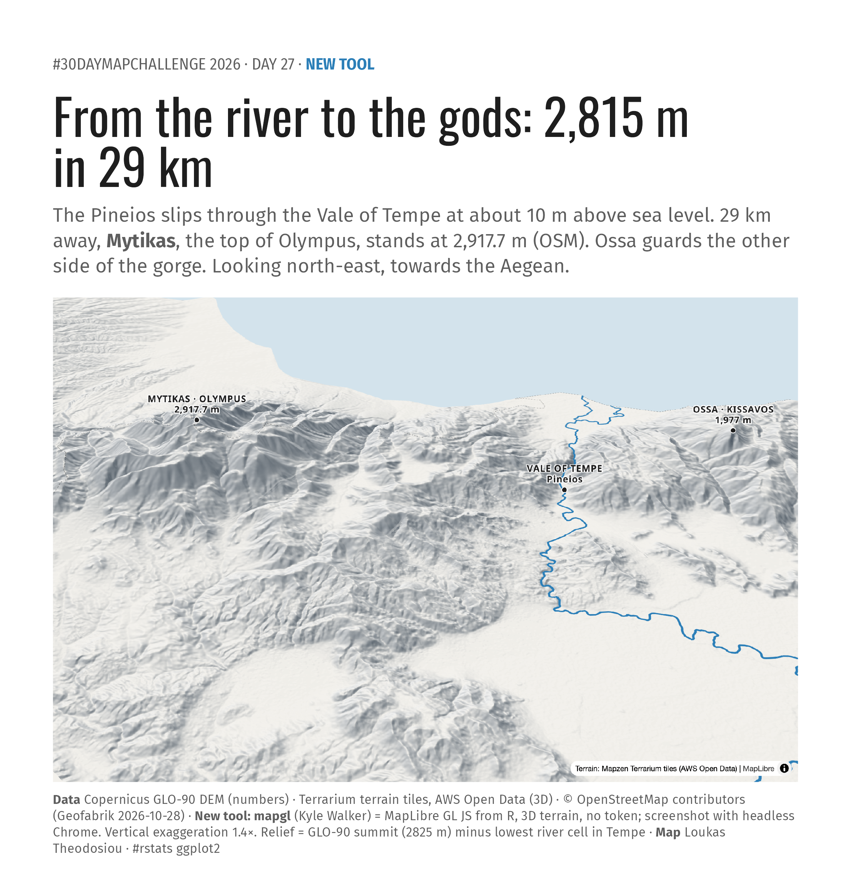](scripts/day27_new_tool.R)

**Idea**
A 3D oblique view of Olympus, the Vale of Tempe and Ossa, made with a tool new to this project: **mapgl**
(Kyle Walker's R interface to MapLibre GL JS) with real terrain in the browser, no token. The title measures
the climb from the Pineios in the gorge to the top of Olympus.

**Data**
- 3D terrain + hillshade: Mapzen/AWS Terrarium elevation tiles — https://registry.opendata.aws/terrain-tiles/ (open data, attribution).
- Numbers: Copernicus GLO-90 DEM via `m30_dem()` — https://registry.opendata.aws/copernicus-dem/ — free licence.
- Peaks + heights: OpenStreetMap `natural=peak` / `natural=mountain_range` with `ele`, Geofabrik Greece extract
  2026-10-28 — https://download.geofabrik.de/europe/greece.html — ODbL. Pineios: OSM `waterway=river`, name Πηνειός.
- Sea: box minus Eurostat GISCO NUTS 2021 land. Label glyphs: OpenFreeMap fonts.

**How**
- GDAL's default `osmconf.ini` drops `ele`, so peaks were re-extracted from `greece.osm.pbf` with a copy that keeps it
  (`30daymap/cache/day27/peaks.gpkg`).
- River level: GLO-90 sampled every 90 m along the OSM Pineios inside the gorge box (22.53–22.60 E, 39.86–39.92 N);
  summit: GLO-90 maximum within 500 m of the OSM Mytikas node; distance = straight line between the two points.
- mapgl `maplibre()` with an own minimal style (DEM sources, terrain, hillshade in the style, because mapgl's
  `add_raster_dem_source()` passes only a TileJSON url, no `tiles`/`encoding`), exaggeration 1.4×, pitch 62°, bearing 50°.
- Screenshot with Chrome's own headless CLI on the Metal GPU (`--use-angle=metal`); chromote/webshot2 (SwiftShader)
  left whole terrain tiles flat. Framed with magick + ggplot2 (`m30_labs`). Live 3D page: `out/day27_new_tool.html`.

**Finding**
- Pineios in Tempe: 10–33 m (GLO-90). Mytikas: 2,825 m in GLO-90, 2,917.7 m in OSM.
- Relief **2,815 m over 29.0 km** (DEM to DEM); 2,908 m if the OSM summit height is used.
- Ossa: 1,977 m (`ele` of the OSM `mountain_range` node Όσσα, which sits on the summit; no peak node has a height there).

**Caveats**
- 90 m DEM smooths the summit (−93 m vs the surveyed height). The 3D view uses a different DEM (Terrarium) than the numbers.
- Vertical exaggeration 1.4× (in the caption). Labels are MapLibre symbols, so their font is Noto Sans (OpenFreeMap glyphs).
- The screenshot needs a Mac with a GPU and internet (tiles); rerunning on another machine may need the chromote path.

**Status**
done

---

## Day 28 · Feeling — 2 August 2021: the plain felt like 46 °C

**R file:** [`scripts/day28_feeling_heat.R`](scripts/day28_feeling_heat.R)

[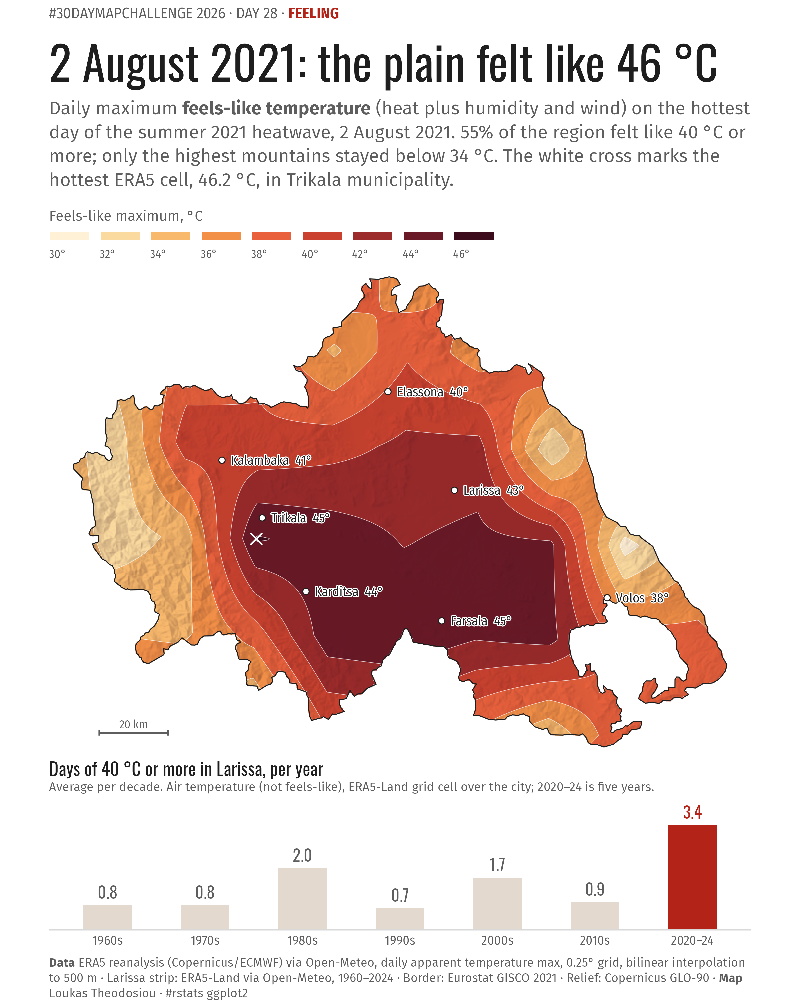](scripts/day28_feeling_heat.R)

**Idea**
How hot it felt, not how hot it was: ERA5 daily maximum apparent (feels-like) temperature on the worst day of the summer 2021 heatwave, over Thessaly. A strip below shows how often Larissa now passes 40 °C.

**Data**
- ERA5 reanalysis (Copernicus/ECMWF) via Open-Meteo historical weather API (`models=era5`, `daily=apparent_temperature_max,temperature_2m_max`), 88 native 0.25° cell centres 21.0–23.5 E × 38.75–40.5 N, 25 Jul–8 Aug 2021, one multi-location request, cached `30daymap/cache/heat2021/era5_apparent_grid.json`. https://archive-api.open-meteo.com/v1/archive — CC BY 4.0.
- Larissa daily ERA5-Land tmax 1960–2024 (Open-Meteo, cell 39.64 N 22.42 E) from `../Thessaly Infographic Installation/data/larissa_daily_era5land.csv`.

**How**
- Hottest day = highest mean feels-like max over the 32 cells in/around the region → 2 Aug 2021 (also Larissa's max day of summer 2021, 45.1 °C).
- Bilinear interpolation of the 0.25° grid to 500 m (a thin-plate spline was tried and dropped: it overshot to 46.9 °C, above any data value), masked to the region, 2 °C filled contours + light hillshade.
- Strip: days with tmax ≥ 40 °C per year, averaged per decade.

**Finding**
2 Aug 2021: hottest ERA5 cell 46.2 °C feels-like at 39.50 N 21.75 E (Trikala municipality, between Trikala and Karditsa); 55% of the region felt ≥ 40 °C; mean over the region 39.6 °C; 5% (high mountains) stayed below 34 °C. Larissa days ≥ 40 °C per year: 1960s 0.8, 1970s 0.8, 1980s 2.0, 1990s 0.7, 2000s 1.7, 2010s 0.9, 2020–24 3.4.

**Caveats**
- ERA5 cells are ~25 km: smooth, misses town heat islands; bilinear interpolation shows soft facets of the grid. Values are reanalysis, not station readings.
- Apparent temperature = Open-Meteo's formula, not the Greek met office index.
- Strip uses air temperature (ERA5-Land), not feels-like; 2020–24 is five years only.

**Status**
done

---

## Day 29 · Raster — 58% of Thessaly's plain is fields

**R file:** [`scripts/day29_raster_landcover.R`](scripts/day29_raster_landcover.R)

[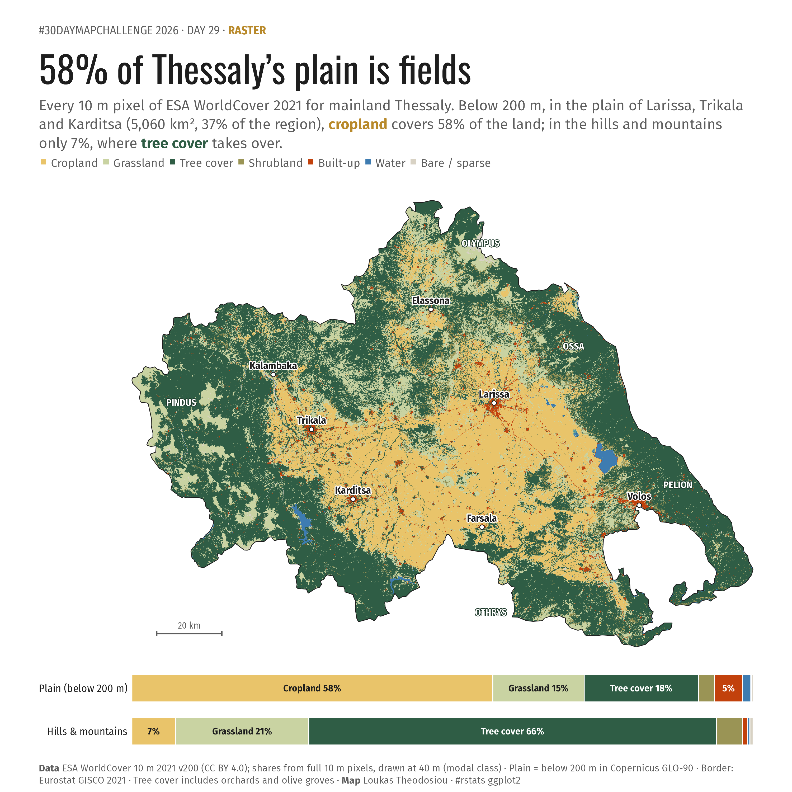](scripts/day29_raster_landcover.R)

**Idea**
The ESA WorldCover 10 m land-cover raster of mainland Thessaly as a print poster: the yellow patchwork of the plain, ringed by the forests of Pindus, Olympus, Ossa, Pelion and Othrys, with towns in built-up red. A strip compares the plain with the hills and mountains.

**Data**
ESA WorldCover 10 m 2021 v200, tiles N39E021 + N36E021, CC BY 4.0 (© ESA WorldCover project 2022 / contains modified Copernicus Sentinel data 2021). https://esa-worldcover.s3.eu-central-1.amazonaws.com/v200/2021/map/ — cached in `30daymap/cache/worldcover/`. Plain = below 200 m in Copernicus GLO-90. Border: Eurostat GISCO 2021.

**How**
- Shares from all 10 m pixels: `terra::crosstab()` of classes × plain/hills zones (`30daymap/data/day29_plain_counts.csv`).
- For drawing only: modal aggregation 4×4 (40 m) → EPSG:2100 nearest neighbour; at 10×10 in, 300 dpi one printed pixel ≈ 60 m, so nothing finer would be visible. Drawn as one RGB image with `annotation_raster()`.
- WorldCover legend colours toned for paper (cropland ochre, tree cover deep green, built-up rust).

**Finding**
Plain (< 200 m) = 5,063 km², 37% of mainland Thessaly. Cropland covers 58.1% of the plain (tree cover 18.4%, grassland 14.7%, built-up 4.5%, water 1.3%) vs 7.1% of the hills and mountains (tree cover 66%).

**Caveats**
- Modal aggregation for the picture slightly favours each block's dominant class (thin roads, small villages fade); the numbers are from the full 10 m data.
- "Tree cover" includes orchards and olive groves (in the plain, part of the 18% is orchards). "Plain" by a 200 m threshold is a simple definition.

**Status**
done

---

## Day 30 · Pen & paper — (title to be written by hand)

**R file:** [`scripts/day30_pen_paper.R`](scripts/day30_pen_paper.R) · [`out/day30_pen_paper_template.pdf`](out/day30_pen_paper_template.pdf)

[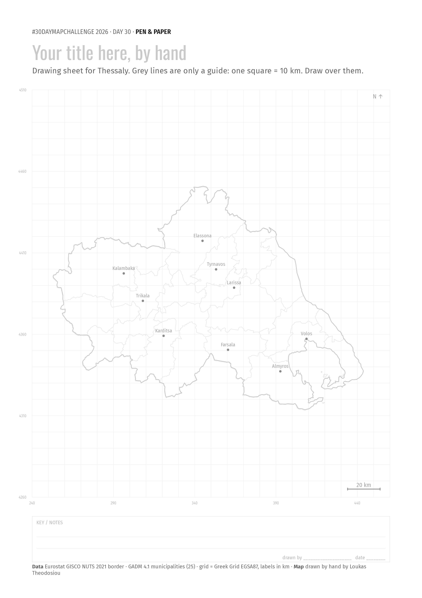](scripts/day30_pen_paper.R)

**Idea**
Loukas draws this map himself. The script only makes the paper: an A4 portrait drawing sheet with a faint
Thessaly outline, the 25 municipality borders very light, the 9 towns as small dots, a 10 km grid in Greek Grid
metres, the series title strip and a key/notes box. After drawing, the scan is framed in the series look.

**Data**
- Region border: Eurostat GISCO NUTS 2021 (EL61) — https://gisco-services.ec.europa.eu/distribution/v2/nuts/ — © EuroGeographics.
- Municipalities: GADM 4.1 level 3 — https://gadm.org — free for non-commercial use.
- Towns: `m30_towns` (town-centre coordinates in `m30_base.R`).

**How**
- Mainland only (Sporades left out to give the mainland the sheet); grid snapped to whole 10 km lines of EPSG:2100,
  stretched north–south to 22 × 25 squares to fill the page; edge labels in km.
- ggplot2 + patchwork; saved as vector PDF (`cairo_pdf`) and 300 dpi PNG at 210 × 297 mm.
- Files: `out/day30_pen_paper_template.pdf`, `out/day30_pen_paper_template.png`.

**Finding**
- Mainland Thessaly fits in 191 × 137 km: about 19 × 14 squares of the grid.

**Caveats**
- Print at 100 % ("actual size") so the 20 km scale bar stays true; the grid squares are 10 km whatever the print scale.
- This is a template, not the Day 30 map. No hand-drawn look was faked.

**Status**
needs Loukas: print the PDF, draw the map by hand, scan it (300 dpi+), then we frame the scan with the series tag, title and caption.
